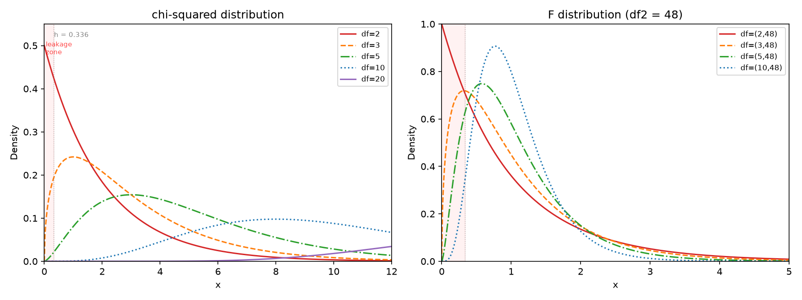

# Supplementary Material

## S1. Overview

This supplement collects the material that the main text refers to but does not carry in full. It has two parts. Sections S2 and S3 report the Kullback-Leibler divergence results, which are a secondary convergence measure and are not the basis of any conclusion in the paper. Sections S4 to S10 hold the expanded tables and diagnostics that the revision moved out of the main text to keep it readable: the cell-by-cell Wilson intervals behind the Study 2 table (S4), the full crossed allocation $\times$ variance grid (S5), the nominal-level grid in full (S6), the Study 2 sample-size sweep in full (S7), the complete positioning table against prior comparative studies (S8), and the two diagnostics for the tests added in this revision (S9, S10). Every section is generated from the results files named in `docs/CODE_MAP.md`, and no conclusion depends on a number that appears only here without also appearing in the main text.

The rest of this section describes the KL material. The KL divergence measures the information loss when the theoretical density $f_0$ approximates the empirical density $\hat{f}$:

$$D_{KL}(\hat{f} \parallel f_0) = \int \hat{f}(x) \ln \frac{\hat{f}(x)}{f_0(x)} dx$$

KL divergence requires estimating $\hat{f}$ from the Monte Carlo sample. We used a Gaussian kernel density estimator (KDE) with Silverman's bandwidth (Silverman, 1986):

$$h = 1.06 \cdot \min(\hat{\sigma}, \text{IQR}/1.34) \cdot N^{-1/5}$$

This rule-of-thumb bandwidth is asymptotically optimal — minimising the integrated mean squared error — under the assumption that the underlying density is approximately normal. Its practical advantages are that it requires no tuning and is universally applicable. Its disadvantage, which is consequential here, is that it over-smooths for non-normal or bounded-support distributions: the bandwidth is wider than optimal, flattening features near the boundary. Because the leakage fraction $\Phi(-X_i/h)$ depends inversely on $h$, a wider bandwidth means more kernel mass from near-boundary observations spills into the negative half-line, amplifying the boundary bias. For $\chi^2(2)$ at $N=10{,}000$, Silverman's rule yields $h \approx 0.336$; a boundary-aware bandwidth selector would produce a substantially smaller value near $x=0$, but at the cost of introducing test-specific tuning parameters that compromise the cross-test comparability we require. However, this estimator suffers from a fundamental boundary bias: six of the ten tests (T3–T6, T8, T9) have $\chi^2$ null distributions and two (T2, T10) have $F$ null distributions, both supported only on $[0,\infty)$. The Gaussian kernel places symmetric probability mass around each observation; for observations near $x=0$, up to half of each kernel's mass spills into the negative half-line where the true density is exactly zero. This systematic leakage underestimates the density near the boundary and biases the KL integral precisely in the low-degrees-of-freedom regime of greatest substantive interest. Given that the Kolmogorov-Smirnov distance already provides a non-parametric, distribution-free CDF-level comparison that is unaffected by boundary issues, we elected not to pursue a repaired KL estimator and instead base all quantitative conclusions in the main text on $D_{KS}$ and the empirical Type I error rate. The KL values reported here (§S2) are computed with the standard Gaussian KDE without correction; a full technical discussion of the boundary bias is provided in §S3.

## S2. KL Divergence Values (Study 1)

Table S1 reports $D_{KL}(\hat{f} \parallel f_0)$ computed via Gaussian KDE with Silverman's bandwidth, for the baseline configuration ($N = 10{,}000$ MC replications, $k = 3$ groups where applicable). A value of 0.0000 indicates the KL divergence was numerically indistinguishable from zero at the grid resolution used.

**Table S1: KL divergence under baseline conditions ($N = 10{,}000$)**

| Test | $n=5$ | $n=10$ | $n=20$ | $n=30$ | $n=50$ | $n=100$ | $n=200$ | $n=500$ |
| --- | --- | --- | --- | --- | --- | --- | --- | --- |
| T1: Student's t | 0.0000 | 0.0000 | 0.0000 | 0.0000 | 0.0000 | 0.0007 | 0.0000 | 0.0005 |
| T2: ANOVA F | 0.0000 | 0.0000 | 0.0000 | 0.0000 | 0.0000 | 0.0000 | 0.0000 | 0.0000 |
| T3: Kruskal-Wallis | 0.0000 | 0.0000 | 0.0000 | 0.0000 | 0.0000 | 0.0000 | 0.0000 | 0.0000 |
| T4: $\chi^2$ GOF | 0.0000 | 0.0000 | 0.0000 | 0.0000 | 0.0000 | 0.0000 | 0.0000 | 0.0000 |
| T5: Bartlett's | 0.0000 | 0.0000 | 0.0000 | 0.0000 | 0.0000 | 0.0000 | 0.0000 | 0.0000 |
| T6: Fligner-Killeen | 0.0742 | 0.0000 | 0.0000 | 0.0000 | 0.0000 | 0.0000 | 0.0000 | 0.0000 |
| T7: Sign test | 0.0003 | 0.0003 | 0.0007 | 0.0013 | 0.0010 | 0.0021 | 0.0031 | 0.0046 |
| T8: Cochran's Q | 0.0172 | 0.0000 | 0.0000 | 0.0000 | 0.0000 | 0.0000 | 0.0000 | 0.0000 |
| T9: Median test | 0.2564 | 0.1536 | 0.0056 | 0.0000 | 0.0000 | 0.0000 | 0.0000 | 0.0000 |
| T10: Hotelling's $T^2$ | 0.2073 | 0.0000 | 0.0000 | 0.0000 | 0.0000 | 0.0000 | 0.0000 | 0.0000 |

**Key observations:**

- With the sole exception of the sign test, all KL values at $n \geq 30$ are numerically zero. Non-zero values occur only at $n \leq 20$: the median test retains a detectable KL signal through $n=20$ (0.2564 $\to$ 0.1536 $\to$ 0.0056), while the other tests with non-zero KL at $n=5$ (Hotelling's $T^2$: 0.2073; Fligner-Killeen: 0.0742; Cochran's Q: 0.0172) collapse to zero by $n=10$. The median test's KL persistence to $n=20$ aligns with its KS distance (0.139 at $n=20$, the largest among all asymptotic tests at that sample size). The sign test's KL values are a known artefact (see below); the few other non-zero entries at larger $n$ (e.g., Student's t at $n=100$: 0.0007) are numerical noise from the KDE integration grid.

- The KL divergence drops to zero far more quickly than the KS distance. For example, Cochran's Q has KL = 0.0172 at $n=5$ and KL = 0.0000 at $n=10$, yet its KS distance remains at 0.060 at $n=10$ and does not fall below the 0.0136 adequacy threshold until $n=200$ (see Table 3, main text).

- **Why KL collapses to zero while KS does not.** This is not because the empirical and theoretical distributions genuinely coincide, but because the KDE — the intermediate estimator required to compute KL — is a *smoothing* operator. The raw ECDF that KS interrogates preserves every empirical irregularity as a stepwise deviation from the theoretical CDF: any mismatch, however local, registers as a vertical gap. The KDE, by fitting a continuous density through those same observations, blends them together: local peaks are flattened, gaps are filled, and the resulting density estimate is inherently closer to the smooth theoretical density than the raw sample is to the theoretical CDF. This smoothing effect is why KL registers non-zero values only at the most extreme $n=5$ configurations — where even the smoothed KDE cannot mask the gross deviation — and collapses to zero everywhere else. The boundary bias at $x=0$ is real but affects only a narrow interval near the origin; the KL integral is dominated by the well-matched bulk of the distribution where smoothing has done its work, so the biased boundary region contributes little to the total integral.

- The sign test's KL values actually *increase* with $n$ (0.0003 at $n=5$ to 0.0046 at $n=500$), despite the fact that the binomial PMF is exact and the distributional fit is perfect (KS = 0.005–0.008 across all $n$). This artefact arises because the sign test statistic $N^+ \sim \text{Binomial}(n, 0.5)$ is discrete, taking values in $\{0, 1, \ldots, n\}$, but KL divergence is defined for continuous densities and requires estimating a smooth $\hat{f}(x)$ via KDE from a discrete sample. At $n=5$, the binomial has only 6 support points; the KDE smears these into a crude continuous approximation, and the KL integral over a coarse grid registers negligible discrepancy. As $n$ grows, the number of support points increases to $n+1$, and the KDE resolves finer detail across more integer gaps. Each gap between consecutive integers is a region where the true PMF has zero probability mass, but the KDE places a smooth continuous bump there — creating a small but accumulating mismatch between $\hat{f}$ (continuous, smooth) and $f_0$ (discrete, atomic). The total KL sums these per-gap contributions, growing with the number of gaps. This is a discretization artefact, not a genuine distributional discrepancy: the binomial null is exact regardless of $n$, and the KS distance — which operates on discrete CDFs directly — confirms this. The sign test's KL values therefore illustrate a fundamental limitation of applying a continuous-density divergence to a discrete-statistic test.

**Conclusion:** The KL divergence values in Table S1 are not interpretable as genuine measures of distributional discrepancy. The systematic boundary bias for $\chi^2$ and $F$ distributions renders the KL estimates unreliable for cross-test comparisons, and the metric's rapid collapse to zero fails to capture the slow convergence behaviour — particular for the median test and Cochran's Q — that the KS distance reveals convincingly.

## S3. Boundary Bias in Gaussian KDE for KL Estimation

### S3.1 Mechanism

The Gaussian KDE estimate at point $x$ is:

$$\hat{f}_h(x) = \frac{1}{N h} \sum_{i=1}^{N} \phi\!\left(\frac{x - X_i}{h}\right)$$

where $N = 10{,}000$ is the number of Monte Carlo replications (the number of test-statistic observations fed into the KDE), $h$ is the bandwidth (Silverman, 1986), $X_i$ are the observed test statistic values, and $\phi$ is the standard normal density (symmetric, support $(-\infty, \infty)$).

For any observation $X_i$, the proportion of its kernel that spills into the negative half-line is:

$$\int_{-\infty}^{0} \frac{1}{h}\,\phi\!\left(\frac{x - X_i}{h}\right) dx = \Phi\!\left(-\frac{X_i}{h}\right)$$

where $\Phi$ is the standard normal CDF. Since the KDE integrates to 1, each observation's kernel contributes mass $1/N$; the fraction $\Phi(-X_i/h)$ of this mass leaks to $x < 0$.

### S3.2 Numerical Example: $\chi^2(2)$

Six of the ten tests (T3–T6, T8, T9) have $\chi^2$ null distributions supported on $[0,\infty)$. For $\chi^2(2)$ with $N = 10{,}000$, Silverman's bandwidth is:

$$h = 1.06 \cdot \hat{\sigma} \cdot N^{-1/5}$$

With $\sigma = \sqrt{4} = 2$:

$$h \approx 1.06 \times 2 \times 10000^{-0.2} = 0.336$$

Leakage fractions for observations at various distances from the boundary:

| Observation $X_i$ | Leakage $\Phi(-X_i/h)$ | Interpretation |
|:---:|:---:|:---|
| 0.05 | 0.44 | 44% of kernel mass spills into $x < 0$ |
| 0.5 | 0.068 | 6.8% leakage |
| 2.0 | $\approx 0$ | negligible |

The pattern is clear: observations near the boundary ($X_i \lesssim h$) leak a substantial fraction of their kernel mass across $x = 0$, while observations more than a few bandwidths away from the boundary are essentially unaffected. Because the $\chi^2$- and $F$-distributed statistics in our study concentrate near zero at small degrees of freedom, a large fraction of all Monte Carlo observations sit in the high-leakage region, making the cumulative boundary bias severe in the low-$n$ regime.

*Figure S1: $\chi^2$ and $F$ densities at various degrees of freedom. The red-shaded region $[0, h]$ marks the high-leakage zone (Silverman bandwidth $h = 0.336$ for $\chi^2(2)$ at $N=10{,}000$). At small degrees of freedom (e.g., $\chi^2(2)$), the density is concentrated near zero, so a large fraction of the Monte Carlo observations fall inside the leakage zone. At larger degrees of freedom, the distribution shifts rightward and becomes bell-shaped, pushing most observations out of the leakage zone and making the boundary bias negligible.*

### S3.3 Consequences

| Effect                                           | Cause                                                                                                                                           |
| ------------------------------------------------ | ----------------------------------------------------------------------------------------------------------------------------------------------- |
| KDE produces $\hat{f}(x) > 0$ for some $x < 0$   | Kernels of observations near zero extend into the negative half-line                                                                            |
| $f_0(x) = 0$ for all $x < 0$                     | $\chi^2$ and $F$ have support $[0, \infty)$; density is analytically zero on the negative half-line                                             |
| Density near $x = 0$ is underestimated           | Probability mass leaked to $x < 0$ must come from somewhere; the normalisation constraint depresses the estimate on $[0, \infty)$               |
| Bias is most severe for small degrees of freedom | For $\chi^2(2)$, $f_0(0) = 0.5$ is the density maximum; observations pile densely near the boundary, maximising total leakage. The symmetric Gaussian kernel cannot reproduce a density that peaks at a hard boundary, biasing the estimate low at $x=0$. |

### S3.4 Possible Remedies

| Method                                                                                                   | Drawback                                                                                           |
| -------------------------------------------------------------------------------------------------------- | -------------------------------------------------------------------------------------------------- |
| **Reflection method**: reflect observations at $x = 0$, estimate on $(-\infty, \infty)$, fold back       | Distorts the density shape near the boundary                                                       |
| **Logarithmic transformation**: transform $X_i \to \ln(X_i)$, KDE on $(-\infty, \infty)$, back-transform | Back-transformation introduces Jacobian instabilities near zero                                    |
| **$k$-nearest-neighbor KL estimator** (Wang et al., 2009)                                                | Avoids bandwidth selection and respects bounded support, but introduces its own bias for small $n$ |
| **Boundary-corrected kernels** (beta, gamma kernels)                                                     | Kernel family choice is distribution-specific; loses generality across the ten tests               |

Given that (a) the KS distance already provides a non-parametric, distribution-free, boundary-unbiased CDF-level comparison, and (b) the empirical Type I error rate provides the most practically relevant tail-level diagnostic, we elected not to pursue a repaired KL estimate. The values in Table S1 are reported for completeness at the standard Gaussian KDE, without correction.

### S3.5 KS versus KL: Why KS is the primary metric

Even setting aside the boundary bias, the KS distance is better suited to the present study for reasons that go beyond implementation convenience:

| Property | KS distance | KL divergence |
|----------|------------|---------------|
| Input | Empirical CDF (no estimation) | Requires density estimate (KDE, bandwidth-dependent) |
| Estimation error | $O(1/\sqrt{N})$ — pure Monte Carlo error, no smoothing bias | Kernel smoothing bias + Monte Carlo error; bandwidth-dependent trade-off |
| Distribution assumption | None (distribution-free) | Underlying density must be estimated; KDE smoothness assumptions |
| Sensitivity to tails | Low — CDF is flat in the tails, so vertical differences are bounded | High — logarithmic scaling amplifies small tail-density differences |
| Sensitivity to shape | Catches global CDF deviation; can miss two distributions with intersecting CDFs but different density shapes (e.g., skewness, peakedness) | Catches local density differences including skewness, kurtosis, multimodality |
| Cross-test comparability | Direct — $D_{KS}$ is on [0,1] and the KS distribution is independent of $F_0$ (under $H_0$) | Indirect — $D_{KL}$ is unbounded, asymmetric, and sensitive to support overlap |
| Cross-$n$ comparability | Stable — convergence of ECDF to CDF is uniform at rate $O(1/\sqrt{N})$ | Unstable — density estimation quality degrades differently at each $n$ due to bandwidth dependence on $N$ |

At $N=10{,}000$, the ECDF is estimated with an accuracy of $O(1/\sqrt{10{,}000}) \approx 0.01$ — already fine enough to resolve the distributional differences across tests we report. The KL divergence's theoretical advantage in sensitivity to local density features is therefore outweighed by the estimation noise introduced by the KDE, even in the absence of boundary leakage. For the purpose of this study — ranking ten tests by their finite-sample convergence rates under a common benchmark — the KS distance's zero-tuning, distribution-free, boundary-unbiased character makes it the more reliable and interpretable metric.

## Reference

Silverman, B. W. (1986). *Density estimation for statistics and data analysis.* Chapman & Hall.

Wang, Q., Kulkarni, S. R., & Verdú, S. (2009). Divergence estimation for multidimensional densities via $k$-nearest-neighbor distances. *IEEE Transactions on Information Theory*, 55(5), 2392–2405.

## S4. Wilson 95% intervals for the Study 2 rejection rates, cell by cell

Referee 1 (comment 6) noted that the original manuscript reported a single generic
interval half-width rather than the interval for each rate. This section gives the
endpoints for every cell of Table 6 of the main text. All intervals are Wilson score
intervals; at $N = 10{,}000$ the half-width is $\approx 0.004$ near $\alpha = 0.05$
but reaches $0.005$–$0.007$ for the extreme rates, so the intervals are not
interchangeable across the table and two rates should not be compared without them.
An em dash marks a scenario that is not defined for that test (see the notes to
Table 6 and Section 5.4).

| Test | Baseline | Skewed | Heavy-tailed | Var. heterog. | Unbalanced | Small exp. freq. |
|---|---|---|---|---|---|---|
| $t$-test | 0.052 [0.048, 0.057] | 0.066 [0.062, 0.071] | 0.045 [0.042, 0.050] | — | — | — |
| ANOVA $F$ | 0.046 [0.042, 0.050] | 0.043 [0.040, 0.048] | 0.048 [0.044, 0.052] | 0.061 [0.056, 0.066] | 0.049 [0.045, 0.053] | — |
| Kruskal-Wallis | 0.046 [0.043, 0.051] | 0.051 [0.047, 0.056] | 0.049 [0.045, 0.054] | 0.064 [0.059, 0.069] | 0.051 [0.047, 0.056] | — |
| $\chi^2$ GOF | 0.049 [0.045, 0.054] | — | — | — | — | 0.051 [0.047, 0.056] |
| Bartlett | 0.048 [0.044, 0.052] | 0.429 [0.419, 0.439] | 0.276 [0.267, 0.285] | — | 0.051 [0.047, 0.056] | — |
| Fligner-Killeen | 0.041 [0.037, 0.045] | 0.119 [0.113, 0.126] | 0.043 [0.039, 0.047] | — | 0.045 [0.041, 0.049] | — |
| Sign test | 0.035 [0.032, 0.039] | 0.031 [0.027, 0.034] | 0.031 [0.028, 0.035] | — | — | — |
| Cochran's $Q$ | 0.050 [0.046, 0.054] | — | — | — | 0.050 [0.046, 0.054] | 0.041 [0.037, 0.045] |
| Median test | 0.043 [0.040, 0.048] | 0.046 [0.042, 0.050] | 0.045 [0.041, 0.050] | 0.056 [0.052, 0.061] | 0.051 [0.047, 0.055] | 0.069 [0.064, 0.074] |
| Hotelling $T^2$ | 0.050 [0.046, 0.054] | 0.076 [0.071, 0.081] | 0.048 [0.044, 0.053] | — | — | — |

## S5. Imbalance crossed with heteroscedasticity, full grid

Fixed total $n_T = 150$, normal parents with equal means, $N = 10{,}000$ per cell, $\alpha = 0.05$. All entries are Type I error rates under a true null of equal means. Columns are the variance vector $(\sigma_1^2,\sigma_2^2,\sigma_3^2)$; rows are the allocation of the 150 observations. The main text reports the reading of this table in Section 5.4; the balanced first row conceals both directions.

**ANOVA $F$**

| Allocation | $\sigma^2$ 1:1:1 | $\sigma^2$ 1:1:4 | $\sigma^2$ 4:1:1 | $\sigma^2$ 1:4:1 | $\sigma^2$ 1:1:9 | $\sigma^2$ 9:1:1 |
|---|---|---|---|---|---|---|
| 1:1:1 | 0.051 | 0.064 | 0.062 | 0.060 | 0.069 | 0.067 |
| 1:1.3:1.6 | 0.048 | 0.040 | 0.089 | 0.062 | 0.039 | 0.125 |
| 1:1.7:2.3 | 0.051 | 0.027 | 0.121 | 0.058 | 0.026 | 0.166 |
| 1:2:3 | 0.049 | 0.023 | 0.141 | 0.064 | 0.014 | 0.201 |
| 1:3.6:6.1 | 0.050 | 0.011 | 0.184 | 0.060 | 0.007 | 0.280 |

**Kruskal-Wallis**

| Allocation | $\sigma^2$ 1:1:1 | $\sigma^2$ 1:1:4 | $\sigma^2$ 4:1:1 | $\sigma^2$ 1:4:1 | $\sigma^2$ 1:1:9 | $\sigma^2$ 9:1:1 |
|---|---|---|---|---|---|---|
| 1:1:1 | 0.050 | 0.059 | 0.057 | 0.057 | 0.062 | 0.063 |
| 1:1.3:1.6 | 0.048 | 0.048 | 0.069 | 0.058 | 0.050 | 0.082 |
| 1:1.7:2.3 | 0.051 | 0.038 | 0.079 | 0.053 | 0.040 | 0.098 |
| 1:2:3 | 0.049 | 0.037 | 0.085 | 0.060 | 0.031 | 0.109 |
| 1:3.6:6.1 | 0.046 | 0.024 | 0.099 | 0.059 | 0.024 | 0.120 |

*60 rate cells.*

## S6. Nominal-level sensitivity in full

Rejection rates at three nominal levels, computed from the same replicate sets so that only the critical value changes. The ratio $\hat{\alpha}/\alpha$ grows as $\alpha$ falls, which is why the manuscript reports both the absolute and the relative distortion. The skewness ladder's remaining rungs are in `rev_results.json`.

| Test | Parent | $\hat{\alpha}$ at $\alpha=0.01$ | at $0.05$ | at $0.10$ |
|---|---|---|---|---|
| T1_t_test | Normal N(0,1) | 0.010 | 0.050 | 0.096 |
| T1_t_test | Exp(1) | 0.021 | 0.065 | 0.115 |
| T2_anova | Normal N(0,1) | 0.009 | 0.048 | 0.099 |
| T2_anova | Exp(1) | 0.009 | 0.047 | 0.098 |
| T3_kruskal_wallis | Normal N(0,1) | 0.009 | 0.048 | 0.099 |
| T3_kruskal_wallis | Exp(1) | 0.010 | 0.052 | 0.103 |
| T5_bartlett | Normal N(0,1) | 0.011 | 0.052 | 0.101 |
| T5_bartlett | Exp(1) | 0.266 | 0.432 | 0.522 |
| T6_fligner_killeen | Normal N(0,1) | 0.009 | 0.045 | 0.096 |
| T6_fligner_killeen | Exp(1) | 0.033 | 0.111 | 0.185 |
| T7_sign_test | Normal N(0,1) | 0.008 | 0.033 | 0.065 |
| T7_sign_test | Exp(1) | 0.007 | 0.036 | 0.070 |
| T9_median_test | Normal N(0,1) | 0.011 | 0.048 | 0.091 |
| T9_median_test | Exp(1) | 0.009 | 0.050 | 0.094 |
| T10_hotelling | Normal N(0,1) | 0.011 | 0.054 | 0.100 |
| T10_hotelling | Exp(1) | 0.027 | 0.074 | 0.127 |

*16 rate cells.*

## S7. Study 2 scenarios across sample sizes, full grid

Per-group $n$ for the multi-group tests, number of blocks for Cochran's $Q$, total $n_T$ for the $\chi^2$ GOF test as noted in the main text. $N = 10{,}000$ in every cell. The main text summarises the three patterns (recovering, worsening, persistent) that this grid supports.

| Test | Scenario | $n=20$ | $n=50$ | $n=100$ | $n=200$ |
|---|---|---|---|---|---|
| Hotelling T2 | baseline | 0.049 | 0.046 | 0.050 | 0.048 |
| Student t | baseline | 0.050 | 0.049 | 0.053 | 0.051 |
| ANOVA F | baseline | 0.051 | 0.051 | 0.050 | 0.050 |
| Kruskal-Wallis | baseline | 0.049 | 0.048 | 0.048 | 0.048 |
| chi2 GOF | baseline | 0.046 | 0.054 | 0.048 | 0.054 |
| Bartlett | baseline | 0.051 | 0.049 | 0.051 | 0.054 |
| Fligner-Killeen | baseline | 0.037 | 0.042 | 0.047 | 0.051 |
| Sign | baseline | 0.043 | 0.034 | 0.037 | 0.040 |
| Cochran Q | baseline | 0.052 | 0.052 | 0.051 | 0.050 |
| Median | baseline | 0.050 | 0.046 | 0.052 | 0.046 |
| Hotelling T2 | skewed | 0.106 | 0.082 | 0.066 | 0.060 |
| Student t | skewed | 0.083 | 0.066 | 0.063 | 0.056 |
| ANOVA F | skewed | 0.044 | 0.049 | 0.049 | 0.051 |
| Kruskal-Wallis | skewed | 0.046 | 0.051 | 0.048 | 0.049 |
| Bartlett | skewed | 0.379 | 0.427 | 0.449 | 0.460 |
| Fligner-Killeen | skewed | 0.085 | 0.111 | 0.134 | 0.147 |
| Sign | skewed | 0.041 | 0.031 | 0.036 | 0.040 |
| Median | skewed | 0.047 | 0.048 | 0.055 | 0.048 |
| Hotelling T2 | heavy_tail | 0.045 | 0.048 | 0.047 | 0.047 |
| Student t | heavy_tail | 0.049 | 0.051 | 0.050 | 0.049 |
| ANOVA F | heavy_tail | 0.050 | 0.048 | 0.053 | 0.052 |
| Kruskal-Wallis | heavy_tail | 0.051 | 0.051 | 0.051 | 0.050 |
| Bartlett | heavy_tail | 0.214 | 0.268 | 0.320 | 0.345 |
| Fligner-Killeen | heavy_tail | 0.040 | 0.044 | 0.050 | 0.052 |
| Sign | heavy_tail | 0.042 | 0.032 | 0.033 | 0.039 |
| Median | heavy_tail | 0.047 | 0.043 | 0.057 | 0.052 |
| ANOVA F | hetero_var | 0.063 | 0.060 | 0.067 | 0.059 |
| Kruskal-Wallis | hetero_var | 0.063 | 0.064 | 0.059 | 0.060 |
| Median | hetero_var | 0.055 | 0.053 | 0.058 | 0.052 |
| ANOVA F | unbalanced | 0.050 | 0.049 | 0.049 | 0.048 |
| Kruskal-Wallis | unbalanced | 0.046 | 0.044 | 0.049 | 0.048 |
| Bartlett | unbalanced | 0.051 | 0.049 | 0.051 | 0.051 |
| Fligner-Killeen | unbalanced | 0.042 | 0.045 | 0.047 | 0.046 |
| Median | unbalanced | 0.058 | 0.049 | 0.052 | 0.049 |
| chi2 GOF | small_freq | 0.049 | 0.052 | 0.049 | 0.051 |
| Cochran Q | small_freq | 0.035 | 0.042 | 0.052 | 0.053 |

*36 rate cells.*

## S8. Full positioning table (prior comparative simulation studies)

Referee 1 asked for a systematic comparison against previous comparative simulation
studies. The main text carries a condensed version (Table 1); the complete table is
reproduced here with the data-generating settings of each study.

| Study | Tests compared | Simulation settings | Evaluation criteria | Relation to this study |
|---|---|---|---|---|
| Box (1953) | Bartlett-type variance tests | non-normal populations; analytic plus small simulation | Type I error; kurtosis dependence | establishes the phenomenon this study quantifies on a common scale |
| Conover, Johnson & Johnson (1981) | about 10 variance homogeneity tests | normal, contaminated and skewed parents; several $n$ | Type I error and power | same test family (T5, T6); no distributional diagnostics and no cross-family comparison |
| Frossard & Renaud (2021) | permutation tests for regression and ANOVA | designer-determined permutation schemes | Monte Carlo precision guidance | addresses RQ3 for one family; no convergence or robustness grid |
| Kelter (2020) | $t$-test, Mann-Whitney $U$ (and Bayesian alternatives) | normal and non-normal parents; several $n$ | Type I and II error rates | two-sample location only; no CDF-based metric |
| Hemerik, Thoresen & Finos (2021) | permutation tests in high-dimensional linear models | $p \gg n$ regimes | Type I error; empirical size | high-dimensional focus; null validity rather than finite-sample convergence |
| Ghosh, Ayyala & Hellebuyck (2021) | high-dimensional mean tests (prepivots) | $p$, $n$ grids | null-distribution validity | multivariate family only; no robustness design |
| Dłotko et al. (2023); Ebner, Eid & Klar (2022) | novel goodness-of-fit statistics | single-family goodness-of-fit settings | null-distribution adequacy | GOF family only; our T4 and T12 provide GOF and independence contrasts |
| El-Horbaty (2023) | variance-component permutation test | mixed models | Monte Carlo precision | RQ3 for one test family |
| **This study** | **14 tests across the $t$, $F$, $\chi^2$, binomial, Cramér-von Mises and high-dimensional $t$ null families** | **identical violation scenarios, sample-size grid, $N=10{,}000$ budget, $\alpha \in \{0.01,0.05,0.10\}$** | **$D_{KS}$ (global CDF), $\hat{\alpha}$ with Wilson intervals (decision boundary), $N^*$ (MC precision), size-adjusted power** | **cross-family, multi-criterion benchmark with sensitivity and power companion analyses** |

## S9. Interaction-difference test (T13): estimator and split diagnostic, full grid

Reduced-budget diagnostic for the T13 pipeline (Section 5.1.2 of the main text). $N_{\mathrm{eff}} = 2{,}000$
except where noted; rejection rates are at nominal 0.05.

**Partial-dependence estimator, fixed 1,000-row training set**

| Analysis size | Estimator | Reference points | Rejections |
|---|---|---|---|
| 100 | grid | 50 | 0.155 |
| 100 | grid | 200 | 0.109 |
| 100 | mc | 50 | 0.156 |
| 100 | mc | 100 | 0.124 |
| 100 | exact | all training rows | 0.105 |
| 200 | grid | 50 | 0.252 |
| 200 | grid | 200 | 0.140 |
| 200 | mc | 50 | 0.229 |
| 200 | mc | 100 | 0.184 |
| 200 | exact | all training rows | 0.140 |
| 500 | grid | 50 | 0.462 |
| 500 | grid | 200 | 0.342 |
| 500 | mc | 50 | 0.407 |
| 500 | mc | 100 | 0.347 |
| 500 | exact | all training rows | 0.275 |

**Training set scaled with the analysis set**

| Split rule | Training rows | Analysis size | Rejections |
|---|---|---|---|
| fixed_1000 | 1000 | 100 | 0.124 |
| fixed_1000 | 1000 | 200 | 0.184 |
| fixed_1000 | 1000 | 500 | 0.347 |
| prop_4x | 400 | 100 | 0.177 |
| prop_4x | 800 | 200 | 0.223 |
| prop_4x | 2000 | 500 | 0.315 |
| prop_8x | 800 | 100 | 0.147 |
| prop_8x | 1600 | 200 | 0.184 |

Verdict recorded with the diagnostic: grid inflation at the largest analysis size 0.187; MC versus exact estimator 0.072; the drift survives the exact estimator (True) and a proportionally grown training set (True).

## S10. Distance-correlation test (T14): local power against a concentrated signal

Generated by `code/gen_dcor_local.py`. The alternative places a quadratic signal in `k_signal` of the `d`
coordinates, `Y_j = a (X_j^2 - 1) + noise`, at amplitude `a = 1` so that the signal variance is 2 against unit
noise. Every cell uses `N = 10,000` replications and the exact finite-sample critical value of T14 at the stated
`n`. `k_signal = 1` is the spatially concentrated alternative and `k_signal = d` the dense one.

| `d` | `k_signal` | `n = 20` | `n = 100` | `n = 200` |
|---|---|---|---|---|
| 2 | 1 | 0.409 | 0.971 | 1.000 |
| 2 | 2 | 0.568 | 1.000 | 1.000 |
| 10 | 1 | 0.081 | 0.154 | 0.281 |
| 10 | 10 | 0.194 | 0.886 | 1.000 |
| 50 | 1 | 0.055 | 0.059 | 0.060 |
| 50 | 50 | 0.085 | 0.220 | 0.471 |

The table shows that power depends on the spatial distribution of the dependence, not only on its strength: at
`d = 50` a signal present in every coordinate is detected with power 0.471 at `n = 200`, while the same signal in
one coordinate is detected at 0.060, which is the nominal level.
