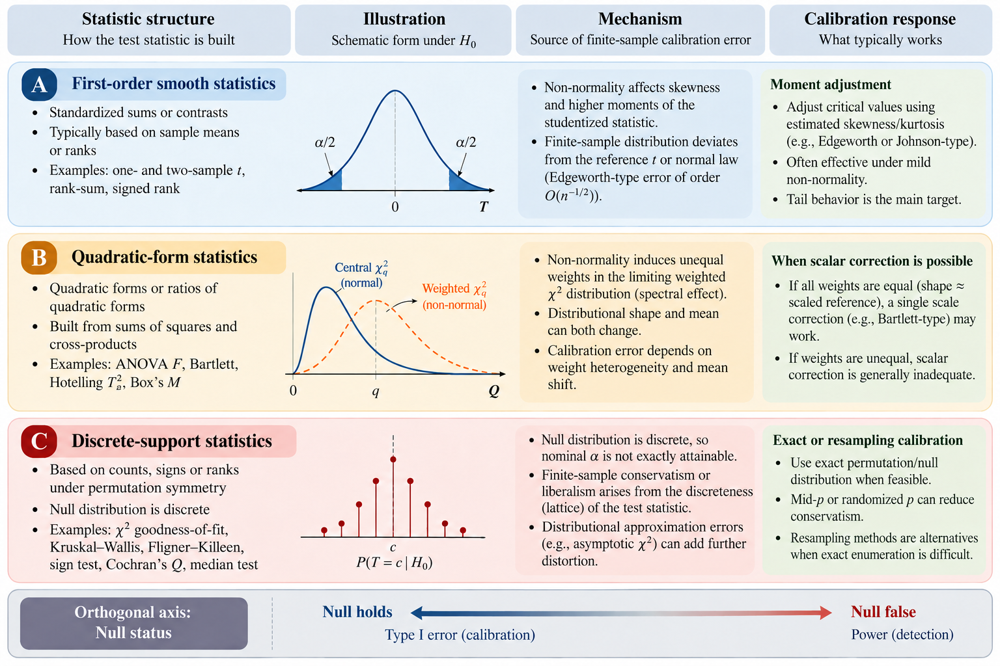
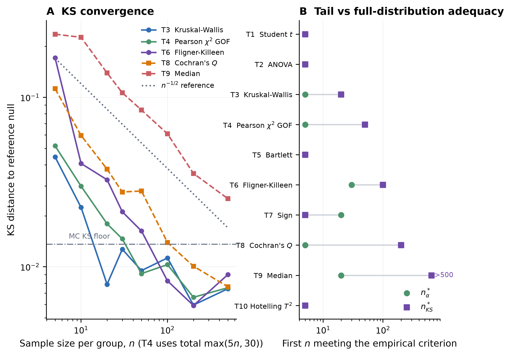
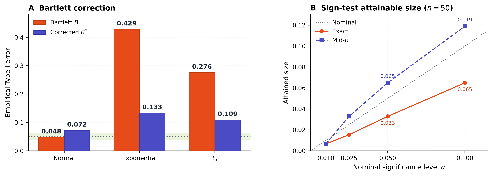
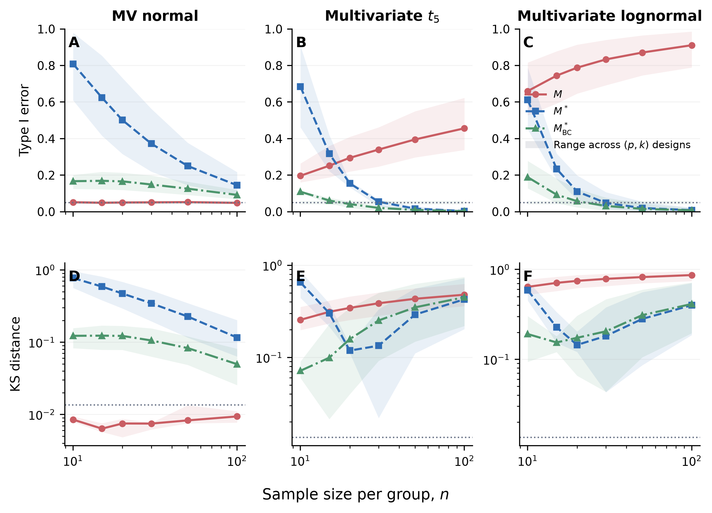

# Finite-Sample Null Calibration Across Eleven Statistical Tests: Mechanisms, Corrections, and Limits

## Abstract

Classical test statistics can depart systematically from their reference null distributions in finite samples. We compare eleven tests using a mechanism-based framework that separates smooth-function Edgeworth error, changes in the limiting law of quadratic statistics, and discrete-support effects. Under ideal sampling, the continuous-valued tests lie near the Monte Carlo resolution floor, while five rank- or count-based procedures show measurable Kolmogorov–Smirnov discrepancies. Under non-normality, Bartlett's variance test is sensitive to kurtosis: the plug-in correction $B^*=B/(1+\hat\gamma_2/2)$ reduces the rejection rate from 0.429 to 0.133 under exponential sampling at $n=50$, without restoring nominal size. The sign-test mid-$p$ rule reduces conservatism but may exceed the nominal level; its apparent power gain disappears when actual size is matched. For multivariate Box's $M$, a direct Mardia-kurtosis analogue is unstable and lacks uniform calibration. Under normality, a classical matrix-Dirichlet representation yields exact cumulants and critical values by deterministic inversion; the uncorrected $\chi^2$ reference has size 0.061–0.146 at nominal 0.05, whereas the Bartlett-adjusted reference has size 0.0500–0.0523 on the examined grid. Under $t_5$ and lognormal parents, unequal asymptotic quadratic-form weights rule out any single scalar correction to a standard chi-square law. A null-imposed bootstrap improves upon pooled-normal resampling outside normality, although it remains liberal in the evaluated small samples. These findings distinguish correctable scale or lattice effects from changes of reference-distribution shape.

**Keywords:** Edgeworth expansion; finite-sample calibration; lattice distribution; Type I error; size-adjusted power; Bartlett test; Box's $M$; Mardia kurtosis; matrix-Dirichlet distribution; saddlepoint approximation; null-imposed bootstrap.

---

## 1. Introduction

Classical tests use exact or asymptotic null distributions to set rejection thresholds (Cramér, 1946; Lehmann and Romano, 2005). An exact law may still depend on restrictive assumptions, while a limiting law can be poorly calibrated at practical sample sizes. These distinctions matter for familiar $t$, $F$, rank, count and covariance-homogeneity procedures, including Box's $M$ (Box, 1949; Anderson, 2003). Prior finite-sample comparisons have usually been study-specific and descriptive rather than structural (Box, 1953; Adebayo and Loko, 2024; Juarros-Basterretxea et al., 2024; Hemming et al., 2025; Bognar et al., 2025), and the adequacy of the nominal reference varies across test families and data types (Uwimpuhwe, Drikvandi and Blozis, 2026; El-Horbaty and Hanafy, 2024; Fitzmaurice et al., 2007; Jan and Shieh, 2025). Comparing rejection rates alone can obscure whether the error arises from a reference approximation, a change in the parent distribution, or discrete support.

Existing finite-sample studies typically examine individual tests or assumptions. We instead apply a common evaluation design to eleven procedures and ask which mathematical features predict calibration error, which corrections address those features, and where correction by a single scale factor is impossible.

We address four questions: (RQ1) Which statistic structures govern the error? (RQ2) How do distributional error and rejection-rate error differ? (RQ3) When do kurtosis or lattice corrections improve size without merely increasing power? (RQ4) What changes for multivariate Box's $M$?

We distinguish three mechanisms: non-degenerate smooth functions of means, quadratic statistics whose null limit may change with fourth moments, and discrete-support statistics. After setting out their conditions, we evaluate two classical corrections, a simulation-based critical-value lookup, and the normal-theory exact reference for Box's $M$. The contribution is a unified diagnosis and controlled comparison—not a claim that the underlying Edgeworth, matrix-Dirichlet or saddlepoint methods are new.

---

## 2. Tests Under Investigation

Table 1 covers ten univariate tests and multivariate Box's $M$, spanning exact and asymptotic $t$, $F$, $\chi^2$ and binomial reference laws. 'Exact' means exact only under the assumptions stated; Box's $M$ has an exact normal-theory law, although the usual $\chi^2$ reference is asymptotic.

**Table 1: The eleven tests, their reference laws, and their calibration mechanisms.**

| ID | Test | Reference law | Mechanism and assumptions |
|---|---|---|---|
| T1 | Student's $t$ | $t(n-1)$, exact under normality | A: smooth function of a mean; $\nabla H\neq 0$ at $H_0$ (Proposition 1) |
| T2 | ANOVA $F$ | $F(k-1,n_T-k)$, exact under normality | B: quadratic ratio; limit parent-free (Proposition 4) |
| T3 | Kruskal–Wallis | $\chi^2(k-1)$, asymptotic, discrete | C: rank/permutation lattice; no closed-form coefficient claimed |
| T4 | Pearson $\chi^2$ GOF | $\chi^2(k-1)$, asymptotic, discrete | C: multinomial-count functional; Cramér's condition fails |
| T5 | Bartlett | $\chi^2(k-1)$, asymptotic; near-exact under normality | B + kurtosis scale; limit changes with $\gamma_2$ (Lemma 1) |
| T6 | Fligner–Killeen | $\chi^2(k-1)$, asymptotic, discrete | C: rank/normal scores; no closed-form coefficient claimed |
| T7 | Sign test | $b(n,1/2)$, exact lattice | C: univariate lattice sum; exact constant in Proposition 3; conservative |
| T8 | Cochran's $Q$ | $\chi^2(k-1)$, asymptotic, discrete | C: block-count statistic; complete block design required |
| T9 | Median test | $\chi^2(k-1)$, asymptotic, discrete | C: $2\times k$ count functional |
| T10 | Hotelling $T^2$ | $\frac{n-p}{p(n-1)}T^2\sim F(p,n-p)$, exact under normality | B: quadratic form; limit parent-free (Proposition 4) |
| T11 | Box's $M$ | $\chi^2(\nu)$, asymptotic; exact matrix-Dirichlet under MVN | B + fourth-cumulant mixture; parent-dependent off MVN (§5) |

Mechanism **A** comprises non-degenerate smooth functions of sample means, with $O(n^{-1/2})$ Edgeworth error under suitable conditions. Mechanism **B** comprises quadratic and likelihood-ratio statistics: their first-order derivative vanishes at the null, and fourth-moment structure can alter the limiting quadratic form. Mechanism **C** comprises lattice, rank and count statistics, for which discrete support affects the CDF and attainable test sizes. The categories describe mechanisms, not whether the stated reference law is exact.

Study 1 varies the sample size under each test's ideal null; Study 2 varies the parent only where that is meaningful. Kruskal–Wallis is exactly distribution-free under a continuous identical-distribution null, whereas the Fligner–Killeen (1976) test has finite-sample parent sensitivity because it ranks deviations from estimated medians. Count-based tests have binomial or multinomial supports rather than a 'normal parent'. In the exponential setting, Fligner–Killeen's observed rejection rate of 0.119 is genuine Type I error inflation because the groups still share the same distribution. Figure 1 summarizes the mechanism-based framework used to examine the eleven tests. Three sources of finite-sample calibration error are distinguished. First, smooth statistics can exhibit Edgeworth-type approximation errors governed by higher-order moments and the structure of the statistic. Second, quadratic-form statistics may have limiting distributions whose scale or shape differs from the nominal reference, particularly under non-normality. Third, discrete statistics may exhibit conservative or liberal rejection rates because their attainable significance levels are restricted by the underlying lattice. These mechanisms motivate different calibration approaches, but no single correction applies universally. Throughout the analysis, calibration under the null is distinguished from power under alternatives.

**Figure 1.** Mechanism-based framework for finite-sample null calibration across statistical tests. The framework distinguishes three mechanisms: (A) smooth, non-degenerate statistics, for which Edgeworth expansions characterize finite-sample approximation errors; (B) quadratic-form and ratio statistics, whose limiting distributions may depend on higher-order moments and exhibit scale or spectral mismatch; and (C) discrete statistics, for which lattice structure restricts attainable significance levels and may introduce additional approximation errors. The right column summarizes potential calibration responses and their limitations. The bottom panel distinguishes Type I error assessment under the null from power evaluation under alternatives.

The three regimes classify tests by their dominant finite-sample calibration mechanisms rather than forming mutually exclusive mathematical families. A statistic may exhibit features of more than one regime; each test is assigned to the regime most relevant to the calibration error examined in this study.

---

## 3. Theoretical Analysis

The mechanism determines what is being approximated: a normal CDF, a weighted quadratic-form law, or a distribution with discrete support. The following statements give the applicable conditions and distinguish established asymptotic results from the empirical comparisons in Section 7.

### 3.1 The standardised mean, and what does (and does not) transfer

For the one-dimensional case, let $X_1,\ldots,X_n$ be i.i.d. with mean $\mu$, variance $\sigma^2>0$, and the moments and non-lattice regularity required for an Edgeworth expansion. Define $Z_n=\sqrt n(\bar X-\mu)/\sigma$.

**Proposition 1 (standardised mean; classical Edgeworth expansion).** Under the stated conditions,
$$P(Z_n\le x)=\Phi(x)+n^{-1/2}\frac{\gamma_1}{6}(1-x^2)\varphi(x)+o(n^{-1/2})$$
uniformly in $x$, where $\gamma_1=\kappa_3/\sigma^3$ is the parent skewness (Edgeworth, 1905; Bhattacharya and Ghosh, 1978). Hence
$D_{KS}(n)=|\gamma_1|\varphi(0)n^{-1/2}/6+o(n^{-1/2})$. If $\gamma_1=0$, the leading term vanishes; an $O(n^{-1})$ rate additionally requires a valid second-order expansion.

For a nonlinear smooth $H$ with $\nabla H(\mu)\neq0$, the error remains $O(n^{-1/2})$ under the conditions of Bhattacharya and Ghosh (1978; see Casini, Deng and Perron, 2026, for recent econometric applications), but its coefficient also depends on derivatives of $H$. For example, with $X_i\sim N(0,1)$ and $H(u)=u+cu^2$,
$$\sqrt n H(\bar X)=Z+c n^{-1/2}Z^2,\quad Z\sim N(0,1),$$
so at fixed $x$, $P\{\sqrt n H(\bar X)\le x\}=\Phi(x)-cn^{-1/2}x^2\varphi(x)+o(n^{-1/2})$. Thus symmetry of the parent alone does not remove the first-order error of a nonlinear transformation. At $c=1$, $x=1$, the exact CDF deviates from $\Phi(1)$ by $-0.00524$ at $n=2{,}000$ and $-0.00169$ at $n=20{,}000$, against the first-order predictions $-0.00541$ and $-0.00171$.

For Student's $t$, $H$ acts on the sample first and second moments and has nonzero gradient under the null. It therefore belongs to mechanism A; under normality its finite-sample $t$ reference is exact.

### 3.2 Lattice sums: structure, one exact constant, and the limits of both

For an integer-valued sum with span $h$ and standard deviation $\sigma_Y$, the standardised lattice spacing is $h/(\sigma_Y\sqrt n)$. This adds a continuity term to the ordinary Edgeworth expansion.

**Proposition 2 (lattice sums).** Under the requisite lattice regularity and moment conditions,
$$F_{Z_n}(x)=\Phi(x)+n^{-1/2}p_1(x)\varphi(x)+n^{-1/2}r_n(x)+O(n^{-1}),$$
where $r_n$ is a bounded periodic continuity term depending on the span and lattice offset. Consequently, its coefficient is model-dependent; a common lattice constant cannot be transferred directly to rank tests or contingency tables (Esseen, 1945; Kolassa and McCullagh, 1990; see Bhattacharya and Rao, 1976, and Read and Cressie, 1988, for the general lattice theory).

**Proposition 3 (symmetric binomial: the exact constant).** Let $S_n\sim\mathrm{Bin}(n,\tfrac12)$ and
$Z_n=(S_n-n/2)/(\sqrt n/2)$. Then
$$D_{KS}(n)=\sup_x\big|P(Z_n\le x)-\Phi(x)\big|=\varphi(0)\,n^{-1/2}+O(n^{-1}),
\qquad \varphi(0)=(2\pi)^{-1/2}=0.3989.$$

*Proof sketch.* The continuity-corrected binomial normal approximation shifts the argument of $\Phi$ by at most $n^{-1/2}$. The bound is attained asymptotically at the central jump (at zero for even $n$, at a neighbouring jump for odd $n$), giving the stated constant. $\square$

The simulated $D_{KS}\sqrt n$ approaches 0.399 for $n=25$–800. This exact coefficient is specific to the symmetric binomial; for rank or multiway count statistics we report empirical KS patterns rather than a comparable closed-form constant.

### 3.3 Quadratic-form and likelihood-ratio statistics

Let $Z_i=g(X_i)\in\mathbb R^d$, $W_n=\sqrt n(\bar Z_n-\mu)\Rightarrow N(0,\Sigma)$, and suppose $H(\mu)=0$, $\nabla H(\mu)=0$ and $A=\nabla^2H(\mu)\neq0$. With a smooth $H$, Taylor expansion gives

$$n\,H(\bar Z_n)=\underbrace{\tfrac12 W_n^\top AW_n}_{Q_n}
+\;n^{-1/2}\,\tfrac16\nabla^3H[W_n]^3+O_p(n^{-1}), \tag{3.1}$$

**Proposition 4 (quadratic-form limit).** If $\mathbb E\|Z\|^2<\infty$,
$$nH(\bar Z_n)\Rightarrow Q=\tfrac12 W^\top AW=\tfrac12\sum_{j=1}^d\lambda_j\chi^2_{1,j},\qquad \lambda_j=\lambda_j(\Sigma^{1/2}A\Sigma^{1/2}),$$
where the components are independent. Moreover, $Q\sim\chi^2_r$ precisely when the nonzero eigenvalues of $\tfrac12\Sigma^{1/2}A\Sigma^{1/2}$ equal one (equivalently, this matrix is a rank-$r$ projection). The factor $1/2$ is essential.

**Proposition 5 (parity cancellation, conditional).** Assume (i) a valid Edgeworth density expansion for $W_n$ to order $n^{-1/2}$ with remainder $o(n^{-1/2})$, (ii) sufficient smoothness, and (iii) an interior point $x$ at which $Q$ has a regular density. Then
$$P\{nH(\bar Z_n)\le x\}=F_Q(x)+o(n^{-1/2}),$$
because the $n^{-1/2}$ coefficient vanishes by parity. If, in addition, (iv) a valid second-order Edgeworth expansion with an $O(n^{-1})$ remainder bound and the corresponding boundary regularity hold, then the same probability equals $F_Q(x)+O(n^{-1})$. For covariance-moment vectors, the second-order expansion in (iv) may require moments of $X$ through order 16; a finite fourth moment alone only guarantees the quadratic-form weak limit.

*Proof sketch.* The $n^{-1/2}$ term combines the odd cubic Edgeworth density polynomial with the odd cubic Taylor perturbation. The region $\{Q\le x\}$ and its boundary are even in $W$, so both integrals vanish by parity; the coefficient of $n^{-1/2}$ is therefore zero. This gives the $o(n^{-1/2})$ statement, while the $O(n^{-1})$ conclusion additionally uses the second-order expansion in (iv). $\square$

The relevant distinction for mechanism B is therefore between a finite-sample error about $F_Q$ that is $o(n^{-1/2})$ (and $O(n^{-1})$ only under the second-order condition in Proposition 5) and any $O(1)$ mismatch between $F_Q$ and the reference law. The latter cannot be removed by a higher-order refinement of the wrong limiting distribution.

The parity argument concerns smooth quadratic statistics with continuous inputs. Discrete rank and count statistics additionally carry lattice terms and require separate treatment.

For covariance statistics, a finite fourth moment of $X$ permits a CLT for $XX^\top$; higher-order expansions require stronger moments. In particular, $t_5$ supports the former but not the latter. Normal, exponential and lognormal parents possess the required finite moments, subject to the other regularity conditions.

### 3.4 The kurtosis connection to Bartlett's test

Bartlett's variance-homogeneity statistic depends on log sample variances. Under a common parent with excess kurtosis $\gamma_2$, $\operatorname{Var}(\log S_j^2)=(\gamma_2+2)/(n_j-1)+o(n_j^{-1})$, rather than the normal-theory $2/(n_j-1)$. Its leading scale is thus $1+\gamma_2/2$ (Box, 1953).

**Lemma 1 (Kurtosis inflation of Bartlett's statistic).** Let $S_j^2$ be the bias-corrected sample variance of group $j$ ($n_j$ observations, parent variance $\sigma^2$, excess kurtosis $\gamma_2 < \infty$), and let $B$ be Bartlett's statistic standardised under the normal-theory variance $2/(n_j-1)$. Then
- (a) $\operatorname{Var}(\log S_j^2) = \dfrac{\gamma_2 + 2}{n_j - 1} + o(n_j^{-1})$;
- (b) $\mathbb{E}[B] = (1 + \gamma_2/2)(k-1) + o(1)$;
- (c) hence $B^* = B/(1 + \gamma_2/2)$ satisfies $\mathbb{E}[B^*] = (k-1) + o(1)$, matching the mean of $\chi^2(k-1)$.

*Proof.* The CLT for $S_j^2$ yields asymptotic variance $(\mu_4-\sigma^4)/(n_j-1)=(\gamma_2+2)\sigma^4/(n_j-1)$. Applying the delta method to $\log S_j^2$ gives (a). The Bartlett quadratic contrast has $k-1$ degrees of freedom and is normalised by the Gaussian variance $2/(n_j-1)$; replacing it with the actual variance gives the factor $1+\gamma_2/2$, proving (b)–(c). $\square$

**Scope.** This common-scale argument requires the groups to share fourth-moment structure, not merely variances. For unit-variance groups drawn respectively from normal, standardised $t_5$ and centred exponential parents ($n=50$), the observed rejection rates at nominal 0.05 were 0.270 ($B$) and 0.125 ($B^*$), compared with 0.050/0.067 in the all-normal cell and 0.424/0.133 in the all-exponential homokurtosis cell: the correction reduces inflation but is not calibrated. The main simulation cells use a common parent, for which the common-kurtosis condition holds.

### 3.5 Sign-test conservatism as a lattice-floor effect

For the exact sign test, a two-sided binomial rejection region can attain only discrete sizes $\alpha^*(n)\le\alpha$. Its gap from the nominal level is a lattice property of an exact null, distinct from the error of approximating a binomial CDF by a normal CDF.

### 3.6 Predictions for the comparative study

The framework makes four testable distinctions. Under ideal sampling, exact reference laws should give negligible population null-distance; smooth quadratic statistics are compared with their appropriate limiting law; rank and count statistics may retain sizeable lattice-related discrepancies. A near-nominal rejection rate at one threshold does not establish distribution-wide calibration. Study 1 examines these signatures rather than claiming to prove a universal convergence rate.

---

## 4. Corrections

We evaluate a kurtosis adjustment for Bartlett's statistic, a mid-$p$ rule for the sign test, and a sample-size-specific empirical threshold for count statistics. These procedures are not alternative estimators of a single target: each targets a different mechanism, and none is proposed as a universal calibration method.

### 4.1 Kurtosis-corrected Bartlett statistic

The pooled plug-in excess kurtosis is

$$\hat\gamma_{2,p} = \frac{1}{k}\sum_{j=1}^k \hat\gamma_{2,j}, \qquad
\hat\gamma_{2,j} = \frac{\frac{1}{n_j}\sum_{i=1}^{n_j}(x_{ji} - \bar{x}_j)^4} {\left[\frac{1}{n_j}\sum_{i=1}^{n_j}(x_{ji} - \bar{x}_j)^2\right]^2} - 3,$$

where $\hat\gamma_{2,j}$ is the within-group excess kurtosis. Bartlett's statistic for equality of $k$ variances (Bartlett, 1937) is
$$B=(n_T-k)\log S_p^2-\sum_{j=1}^k(n_j-1)\log S_j^2,$$
where $S_j^2$ is the unbiased sample variance of group $j$ and $S_p^2$ the pooled variance; under normality $B$ is asymptotically $\chi^2_{k-1}$. The **kurtosis-corrected Bartlett statistic** is
$$B^* = \frac{B}{1 + \hat\gamma_{2,p}/2}.$$
For a common parent with a finite fourth moment and a positive limiting denominator, $B^*$ removes the leading kurtosis scale factor; the finite-sample plug-in remains variable and may be biased. The implementation floors nonpositive denominators at $10^{-6}$, so it must not be treated as an exact small-sample calibration (Box and Andersen, 1955).

### 4.2 Mid-$p$ sign test

For $N^+$ positive signs among $n$ nonzero observations, the ordinary two-sided sign-test $p$-value doubles the smaller binomial tail. The **mid-$p$ value** (Lancaster, 1961) subtracts half the observed probability atom from the smaller tail:

$$\text{mid-}p = 2 \times \min\Big\{P(X < N^+) + \tfrac12 P(X = N^+),\;
                                       P(X > N^+) + \tfrac12 P(X = N^+)\Big\}.$$

Mid-$p$ usually reduces conservatism but does not strictly control size. At nominal 0.05, its exact binomial size is approximately 0.041, 0.065 and 0.057 at $n=20,50,100$; the attained level depends on the sample size, not the continuous parent distribution.

### 4.3 Empirical critical-value look-up for lattice tests

For Cochran's $Q$ and the median test, discrete support shifts right-tail thresholds non-monotonically. In the evaluated median-test design, the estimated 95th percentile is 6.96 at $n=5$ and 5.60 at $n=10$, compared with the $\chi^2_2$ threshold 5.99.

Table S1 gives empirical cut-offs from 10,000 null simulations per configuration. They are scenario-specific estimates, not analytic corrections; because the same simulation batch was used for calibration and evaluation, they are descriptive rather than independently validated critical values. Table 4 uses these cut-offs only as an in-sample illustration, not as a validated size guarantee; an independent calibration set or conditional randomisation would be needed before operational use; bootstrap or permutation calibration (Efron and Tibshirani, 1993; Hall, 1992) would avoid the lookup altogether.

---

## 5. Multivariate Extension: Box's $M$ and the Limits of Scalar Kurtosis Correction

Box's $M$ provides a multivariate test of the limits of the univariate kurtosis correction. We first consider a direct Mardia-kurtosis analogue, then evaluate it against the normal-theory exact distribution and the non-normal quadratic-form limit.

### 5.1 Box's $M$ test for equality of covariance matrices

Let group $j$ contain $n_j$ independent $p$-vectors with covariance $\Sigma_j$. The null is

$$H_0: \Sigma_1 = \Sigma_2 = \cdots = \Sigma_k = \Sigma,$$

Define the within-group and pooled sample covariance matrices:

$$S_j = \frac{1}{n_j - 1} \sum_{i=1}^{n_j} (X_{ji} - \bar{X}_j)(X_{ji} - \bar{X}_j)^\top,$$

and

$$S_p = \frac{1}{n_T - k} \sum_{j=1}^k (n_j - 1) S_j, \qquad n_T = \sum_{j=1}^k n_j.$$

With $m_j=n_j-1$ and $q_0=\sum_jm_j=n_T-k$, the raw normal-theory likelihood-ratio statistic is

$$M_{\text{raw}} = q_0 \ln|S_p| - \sum_{j=1}^k m_j \ln|S_j|,$$

Under multivariate normality and $H_0$, $M_{\rm raw}$ has asymptotic reference $\chi^2_\nu$, $\nu=p(p+1)(k-1)/2$. Its classical Bartlett factor is

$$c = \frac{2p^2 + 3p - 1}{6(p+1)(k-1)} \left( \sum_{j=1}^k \frac{1}{m_j} - \frac{1}{q_0} \right),
\qquad M = (1 - c)\, M_{\text{raw}}$$

This corrects the leading normal-theory approximation error (Box, 1949); it is not a remedy for non-normality, whose effect on $M$ is well documented and grows with dimension (Box, 1953; Tiku and Balakrishnan, 1984; Wilcox, 1987; O'Brien, 1992). At $p=1$, the construction reduces to univariate Bartlett's variance test.

### 5.2 Mardia's multivariate sample kurtosis

Mardia's sample kurtosis (Mardia, 1970, 1974) averages squared Mahalanobis distances. With maximum-likelihood covariance (divisor $n$), it is

$$b_{2,p} = \frac{1}{n} \sum_{i=1}^n \big[ (X_i - \bar{X})^\top S^{-1} (X_i - \bar{X}) \big]^2 .$$

The population normal-theory benchmark is

$$\beta_{2,p} = \mathbb{E}\big[(X - \mu)^\top \Sigma^{-1} (X - \mu)\big]^2 = p(p+2).$$

Sample and population excess kurtosis are, respectively,

$$B_2 := b_{2,p} - p(p+2) \quad\text{(sample)},
\qquad \beta_{2,p} - p(p+2) \quad\text{(population)}$$

At $p=1$, this reduces to univariate excess kurtosis. Under normality the MLE-covariance estimator has expectation $p(p+2)(n-1)/(n+1)$, making its finite-sample downward bias material (Mardia, 1970).

For independent groups, use the pooled estimator

$$b_{2,p}^{\text{(pooled)}} = \frac{1}{n_T} \sum_{j=1}^k n_j \, b_{2,p}^{(j)},$$

with $b_{2,p}^{(j)}$ computed within each group. Throughout, the kurtosis covariance uses divisor $n_j$; the Box statistic itself uses the usual $n_j-1$ covariance. Mixing these conventions changes the bias correction.

### 5.3 The univariate analogy and the candidate adjustment $M^*$

The univariate correction is

$$B^* = \frac{B}{1+\hat\gamma_2/2}.$$

Replacing excess kurtosis by its pooled multivariate analogue yields

$$M^* = \frac{M}{1 + \dfrac{b_{2,p}^{\text{(pooled)}} - p(p+2)}{2}} ,\tag{5.1}$$

which nests the univariate correction. A bias-adjusted variant is

$$M^*_{\text{BC}} = \frac{M}{1 + \dfrac{b_{2,p}^{\text{(pooled, BC)}} - p(p+2)}{2}},
\qquad b_{2,p}^{\text{(BC)}} = b_{2,p}\,\frac{n+1}{n-1} ,\tag{5.2}$$

Here $b_{2,p}^{(\mathrm{pooled,BC})}$ applies the indicated group-wise normal-theory bias factor. Both ratios floor the denominator at $10^{-6}$ in the evaluated implementation.

Neither formula is a generally justified multivariate pivot. The univariate argument establishes a common variance scale; multivariate Edgeworth expansions show that a fourth-cumulant tensor can instead alter several eigenvalues (Wakaki, 1990; Fujikoshi, Ulyanov and Shimizu, 2010; Zuo, Balakrishnan and Yin, 2026). Finite-sample bias and ratio instability add separate problems.

**Dependence.** The pooled log-determinant and the group log-determinants are correlated; treating them as independent terms invalidates a naïve extension of the univariate variance argument.

**Bias.** Normal-theory Mardia kurtosis is downward-biased, reducing the estimated denominator and inflating $M^*$. Bias correction helps but does not remove estimator variance or correlation with $M$.

**Instability.** Under normality, the estimated denominator is nonpositive in 26.5% of simulations at $p=2,k=2,n=10$ and 83.3% at $p=3,k=3,n=10$. Flooring forces large statistics and spurious rejections; even retaining only positive denominators leaves substantial inflation (Table 5).

**Shape.** A scalar divisor can match a $\chi^2$ reference only when all nonzero asymptotic quadratic-form weights coincide. Sections 5.4–5.6 establish the normal reference and the non-normal boundary.

### 5.4 The exact null law under multivariate normality

The exact normal-theory distribution of Box's $M$ is classical (Box, 1949; Muirhead, 1982; Gupta and Tang, 1984); saddlepoint and near-exact computations are also established (Butler, Booth and Huzurbazar, 1993; Booth et al., 1995; Marques, Coelho and Arnold, 2011; Coelho and Marques, 2012; Wu, Massam and Wong, 2014). We use this distribution as a benchmark rather than claim it as a new theorem.

**Theorem 5.1 (matrix-Dirichlet representation).** Under $H_0$ and independent $N_p(\mu_j,\Sigma)$ groups, put $W_j=m_jS_j$, $A=\sum_jW_j=q_0S_p$ and $B_j=A^{-1/2}W_jA^{-1/2}$. Then

$$M_{\text{raw}} = -\sum_{j=1}^k m_j\log|B_j| + p\Big(\sum_{j=1}^k m_j\log m_j - q_0\log q_0\Big)
\qquad\text{identically}, \tag{5.3}$$

and $(B_1,\ldots,B_k)\sim\mathrm{MD}_p(m_1/2,\ldots,m_k/2)$, independently of $A\sim W_p(q_0,\Sigma)$.

*Proof.* The $W_j$ are independent Wishart matrices; their sum and the normalised matrices factor into independent Wishart and matrix-Dirichlet components (Muirhead, 1982; Gupta and Nagar, 2000; Bobecka, Emilion and Wesołowski, 2010). Since $|S_j|=|W_j|/m_j^p$ and $|S_p|=|A|/q_0^p$, substitution gives

$$M_{\text{raw}} = q_0\log|A| - q_0p\log q_0
                  - \sum_j m_j\log|A| + \sum_j m_j\,p\log m_j
                  - \sum_j m_j\log|B_j| .$$

The $|A|$ terms cancel exactly because $q_0=\sum_jm_j$, leaving (5.3). $\square$

**Theorem 5.2 (closed-form cumulant generating function).** Under Theorem 5.1, for $t<\min_j(m_j-p+1)/(2m_j)$, the CGF of $M_{\rm raw}$ is

$$K(t) = \sum_{j=1}^k\Big[\log\Gamma_p\big(\tfrac{m_j}{2}-m_jt\big)
        -\log\Gamma_p\big(\tfrac{m_j}{2}\big)\Big]
        - \Big[\log\Gamma_p\big(\tfrac{q_0}{2}-q_0t\big)
        -\log\Gamma_p\big(\tfrac{q_0}{2}\big)\Big]
        + pt\Big(\sum_{j=1}^k m_j\log m_j - q_0\log q_0\Big), \tag{5.4}$$

where $\Gamma_p(a)=\pi^{p(p-1)/4}\prod_{i=1}^p\Gamma\big(a-\frac{i-1}{2}\big)$ is the multivariate
gamma function.

*Proof.* Apply the matrix-Dirichlet determinant-moment identity

$$\mathbb{E}\Big[\prod_{j=1}^k|B_j|^{s_j}\Big]
 = \frac{\Gamma_p\big(\sum_ja_j\big)}{\prod_j\Gamma_p(a_j)}
   \cdot \frac{\prod_j\Gamma_p(a_j+s_j)}{\Gamma_p\big(\sum_j(a_j+s_j)\big)} ,$$

with $a_j=m_j/2$ and $s_j=-m_jt$, then take logarithms and add the constant in (5.3). $\square$

**Corollary 5.1.** The exact mean and variance are $K'(0)$ and $K''(0)$ (Table 2). The analytic cumulants agree with the independent normal Monte Carlo check to within 0.3%.

**Table 2: Exact cumulants of $M_{\text{raw}}$ under multivariate normality, against their classical limits.**

| $n$ | $k$ | $p$ | exact $\mathbb{E}[M_{\text{raw}}]$ | $\nu$ | exact $\mathrm{Var}$ | $2\nu$ | ratio |
|---|---|---|---|---|---|---|---|
| 10 | 2 | 2 | 3.4101 | 3 | 7.7513 | 6 | 1.292 |
| 20 | 2 | 2 | 3.1813 | 3 | 6.7470 | 6 | 1.125 |
| 50 | 2 | 2 | 3.0678 | 3 | 6.2743 | 6 | 1.046 |
| 100 | 2 | 2 | 3.0332 | 3 | 6.1335 | 6 | 1.022 |
| 30 | 3 | 3 | 12.6344 | 12 | 26.6158 | 24 | 1.109 |

The exact variance exceeds the limiting $2\nu$ by 29% at $n=10$ in the first row, even though the mean is already near $\nu$. Mean matching alone therefore cannot ensure correct upper-tail size.

**Corollary 5.2.** At $p=1$, $\Gamma_p$ reduces to the ordinary gamma function and the representation recovers the univariate Bartlett case.

### 5.5 Exact critical values and the cost of the $\chi^2$ reference

The CGF gives upper-tail critical values without Monte Carlo using either a saddlepoint approximation or deterministic contour inversion.

**Saddlepoint approximation.** Solve $K'(\hat t)=x$ and use the Lugannani–Rice (1980) upper-tail expression

$$P(M_{\rm raw}\ge x) \approx 1-\Phi(w) + \phi(w)\Big(\frac{1}{u}-\frac{1}{w}\Big), \qquad
w=\mathrm{sgn}(\hat{t})\sqrt{2\big(\hat{t}x-K(\hat{t})\big)}, \qquad
u=\hat{t}\sqrt{K''(\hat{t})}. \tag{5.5}$$

Equation (5.5) is the Lugannani–Rice (1980) formula; the Skovgaard (1987) variant has the same first-order accuracy and is preferable when the saddlepoint is near zero. Invert (5.5) in $x$. **Deterministic inversion** evaluates the Bromwich integral along $z=\hat t+is$:

$$P(M_{\rm raw}\ge x) = \frac{1}{2\pi}\int_{-\infty}^{\infty}
\frac{e^{K(\hat{t}+is)-(\hat{t}+is)x}}{\hat{t}+is}\,ds
= \frac{1}{\pi}\int_0^{\infty}
\mathrm{Re}\Big[\frac{e^{K(\hat{t}+is)-(\hat{t}+is)x}}{\hat{t}+is}\Big]\,ds , \tag{5.6}$$

Equations (5.5)–(5.6) use the CGF of $M_{\rm raw}$. For the Bartlett-adjusted statistic $M=(1-c)M_{\rm raw}$, evaluate its tail at $x/(1-c)$. The deterministic calculation is exact relative to the specified CGF up to quadrature and truncation error. Numerical implementation uses controlled step sizes and tail extrapolation; it does not use Monte Carlo to obtain critical values.

Validation included known $\chi^2$ CGFs, the representation identity, derivative checks and an independent $400{,}000$-replication reference. The deterministic inversion and saddlepoint critical values agree with that reference within about 0.60% and 0.51%, respectively, on the reported grid.

The full numerical comparison, including saddlepoint, exact inversion, Monte Carlo and $\chi^2_\nu$ critical values, is reported in Table S2. In particular, the $\chi^2_\nu$ critical value is too small in every listed design, causing liberal tests; errors are largest when $p$ is large relative to group size.

**Table 3: Exact size at $\alpha=0.05$, computed from (5.4) with no simulation.**

| $p$ | $n$ | $k$ | $\nu$ | $\chi^2_\nu$ on $M_{\text{raw}}$ | $\chi^2_\nu$ on $M=(1-c)M_{\text{raw}}$ | saddlepoint rule |
|---|---|---|---|---|---|---|
| 2 | 20 | 2 | 3 | 0.0610 | 0.0500 | 0.0498 |
| 2 | 20 | 3 | 6 | 0.0631 | 0.0500 | 0.0499 |
| 2 | 50 | 2 | 3 | 0.0540 | 0.0500 | 0.0498 |
| 2 | 100 | 2 | 3 | 0.0520 | 0.0500 | 0.0498 |
| 3 | 20 | 2 | 6 | 0.0740 | 0.0503 | 0.0500 |
| 3 | 20 | 3 | 12 | 0.0792 | 0.0504 | 0.0500 |
| 3 | 100 | 3 | 12 | 0.0547 | 0.0500 | 0.0500 |
| 5 | 20 | 2 | 15 | 0.1248 | 0.0516 | 0.0500 |
| 5 | 20 | 3 | 30 | 0.1462 | 0.0523 | 0.0500 |

Using the exact normal reference gives nominal size by construction (within numerical error). The classical Bartlett factor provides an inexpensive approximation: in the examined designs it reduces the uncorrected size range 0.061–0.146 to 0.0500–0.0523 (Table 3).

### 5.6 The boundary: unequal weights and the limits of scalar correction

The matrix-Dirichlet representation requires a multivariate normal parent. Outside normality, the covariance-matrix CLT still yields a quadratic-form limit under a finite fourth moment, but its weights depend on the fourth-cumulant tensor (for the univariate variance-ratio case see Tonda and Wakaki, 2003).

When the nonzero weights in $Q=\sum_jw_j\chi^2_{1,j}$ are unequal, no scalar multiplier can transform its distribution into $\chi^2_\nu$. The statement is conditional: non-normality alone does not guarantee unequal weights, since some non-Gaussian parents have Gaussian fourth-moment structure (Yanagihara, Tonda and Matsumoto, 2005).

Appendix A diagonalises the covariance of the half-vectorised sample covariance matrix for the equal-group design. At $p=2$, the normal parent has weights $(1,1,1)$, the shared-scale $t_5$ parent $(5,3,3)$, and the independent-coordinate lognormal parent $(56.47,56.47,1)$; each weight is repeated $k-1$ times. Because the latter sets are unequal, neither a classical Bartlett factor nor Mardia's scalar ratio can produce a standard chi-square limit. The sum of the weights is the asymptotic mean of $M_{\rm raw}$: it equals $3$ under normality but $11$ under $t_5$ and $113.94$ under the lognormal parent for $p=2$, $k=2$, so the non-normal null differs in both mean and spread rather than by a single scale factor.

Resampling depends on the null it enforces. Permuting group labels requires exchangeability of the complete distributions, stronger than equality of covariance matrices. A pooled-normal parametric bootstrap discards non-normal fourth-moment structure. Resampling centred residuals within groups does not impose covariance equality. A **null-imposed** bootstrap standardises each group's residuals and rescales them to a common pooled covariance, retaining differences in distributional shape; it improves size but is still liberal for $n=30$ in the examined non-normal cells (Table 8).

### 5.7 The regime taxonomy extended

Box's $M$ falls into mechanism B: its first derivative vanishes under the null, and fourth cumulants affect the quadratic-form limit. Under normality use the exact matrix-Dirichlet reference or its classical Bartlett approximation. Under non-normality with unequal weights, calibration requires a different reference or a null-valid resampling method, not a scalar kurtosis adjustment. Multivariate sign and rank procedures whose null laws sit on discrete grids (Liao and Cape, 2026) would additionally carry lattice terms, so the regime split persists in higher dimension.

---

## 6. Methodology: Unified Monte Carlo Design

### 6.1 General design

We estimate KS distance from the reference CDF and empirical rejection probability $\hat\alpha$ under the relevant null. Unless otherwise specified, each scenario uses 10,000 replications; Wilson intervals for rejection rates and detailed results are in `results/experiment_results.json`.

For Box's $M$, we cross $p\in\{2,3\}$, $k\in\{2,3\}$ and per-group $n\in\{10,15,20,30,50,100\}$ under multivariate normal, $t_5$ and lognormal nulls.

### 6.2 Simulation studies and real-data illustration

**Study 1 (convergence).** Under ideal nulls, vary $n=5,10,20,30,50,100,200,500$ and fit $\log D_{KS}=a+b\log n$. We record $n^*_{\alpha}$, the first observed $n$ with $|\hat\alpha-0.05|<0.01$, and $n^*_{KS}$, the first with $D_{KS}<1.358/\sqrt{10{,}000}=0.0136$. These are descriptive thresholds on the tested grid, not population guarantees.

**Study 1b (simulation resolution).** Re-estimate the discrete-test KS distances at $N=50{,}000$ and, for selected cells, $200{,}000$ replications, separating persistent distributional distance from the $N^{-1/2}$ Monte Carlo floor (Table S8).

**Study 2 (robustness).** At $n=50$, vary skewness, tail weight, group variances, allocation and expected counts (Table S3). For comparisons where the altered configuration makes a test's null false, observed rejection is interpreted as power, not a Type I error.

**Paired comparisons.** On each generated dataset compute both the original and corrected rules, at $\alpha=0.01,0.025,0.05,0.10$. Report the paired difference (corrected minus original) and its confidence interval (Table 6).

**Study 3 (Monte Carlo precision).** For $n=50$, vary $N$ from 100 to 50,000 and repeat each setting 30 times. Report the first $N$ at which $\mathrm{CV}(\hat\alpha)<0.10$.

**Study 4 (examples).** Apply $B^*$ to two features of the Wine dataset and mid-$p$ to the `mtcars` mileage data. These illustrate decision changes; they do not validate population error rates.

**Study 5 (power and resampling).** Compare four tests under specified alternatives, reporting power with actual size and, separately, with independently estimated size-adjusted thresholds. For the discrete sign test, randomisation at the boundary permits a theoretical size of 5%; finite-sample estimated thresholds are assessed on independent null draws. For Box's $M$, compare pooled-normal, within-group, null-imposed and permutation schemes (Table 8).

### 6.3 Software and reproducibility

`experiment.py` creates the result JSON, manifest, derived tables and figures. The manifest records versions, seed and commit; the schema check rejects missing table fields. `--exact-null` regenerates exact benchmark tables, `--figures-only` redraws all four figures, and `--rebuild-reference` separately regenerates the independent Monte Carlo reference.

---

## 7. Results

### 7.1 Study 1: Convergence-rate validation

Under the baseline null, the five above-floor KS curves belong to discrete-valued tests (T3, T4, T6, T8 and T9); the continuous-valued tests remain near simulation resolution (Figure 2). The empirical slopes and the two adequacy thresholds are reported in Table S4. A fitted slope consistent with $-1/2$ supports the lattice prediction but does not prove a rate.

**Figure 2.** (A) Baseline KS convergence for the asymptotic-reference discrete tests (T3, T4, T6, T8 and T9); the sign test uses an exact binomial reference and is not shown because its error is driven by lattice attainability rather than by the curves plotted here. (B) First sample size meeting each empirical criterion, $n^*_{\alpha}$ and $n^*_{KS}$; these are grid-specific descriptive thresholds, not population sample-size guarantees. The $N=10{,}000$ line indicates simulation resolution; Box's $M$ is shown in Figure 4.

The $1.358/\sqrt N$ cut-off determines whether estimated KS distance can be distinguished from Monte Carlo noise; it does not certify that the true CDF is close to the reference. The divergence between $n^*_{\alpha}$ and $n^*_{KS}$ is therefore informative but should be read only on the reported sample-size grid.

At normal-theory baselines, $t$, ANOVA and Hotelling's $T^2$ use exact finite-sample references. Bartlett uses its near-exact normal-theory reference and Box's $M$ the exact matrix-Dirichlet law. Their apparent KS slopes are consequently dominated by Monte Carlo error.

The discrete tests have fitted slopes between approximately $-0.35$ and $-0.65$. In particular, a near-nominal rejection probability does not imply CDF-wide agreement: Cochran's $Q$ and the median test reach size adequacy sooner than KS adequacy.

### 7.2 Study 2: Robustness and correction performance

Table 4 compares the baseline with five departures from ideal assumptions. The corrected and uncorrected values in this table originate from separate simulation batches; Section 7.6 therefore supplies paired comparisons.

For Bartlett's test we assess the change in absolute size error using

$$\text{Calibration Improvement} = \frac{|\hat\alpha_{\text{before}} - 0.05| - |\hat\alpha_{\text{after}} - 0.05|}{|\hat\alpha_{\text{before}} - 0.05|}.$$

With centred exponential data, $B^*$ changes the rejection rate from 0.429 to 0.133 at nominal 0.05, removing roughly three quarters of the absolute size error but leaving material inflation. The correction is not universally beneficial: under normality and some unbalanced designs it increases rejection.

For the sign test, mid-$p$ moves the exact rule's conservatism toward, and sometimes beyond, the nominal level. At $n=50$, its exact attained size at nominal 0.05 is approximately 0.065. Section 7.6 compares both rules across four levels and evaluates power at matched actual size.

Fligner–Killeen is liberal under identical exponential populations ($\hat\alpha=0.119$). Because all groups share the same parent, this is genuine Type I error inflation arising from imperfect calibration of the asymptotic $\chi^2$ reference, not a violated null or a power effect; the implemented statistic agrees with `scipy.stats.fligner` to machine precision. Unequal variances render some equal-distribution nulls false; their rejection rates in those cells describe power (Table 4). Figure 3 displays the correction effects for Bartlett and the sign-test lattice.

**Figure 3.** (A) Empirical rejection rates for Bartlett's test before and after the kurtosis correction under normal, exponential and $t_5$ parents; the horizontal line denotes nominal size 0.05. (B) Exact attainable size of the exact and mid-$p$ sign tests as a function of the nominal level at $n=50$, calculated from the binomial null without simulation; the diagonal is the nominal level. The two panels use different evaluation metrics and are not a common rejection-rate comparison.

**Table 4: Empirical Type I error (bias $\hat\alpha - 0.05$ in parentheses) under distributional violations ($\alpha = 0.05$, $n = 50$, $N = 10{,}000$). For corrected columns, Calibration Improvement is shown as a percentage. Only the tests exercised by the non-normality scenarios (Exp, $t(5)$) are shown; the full scenario-by-test matrix is available in the accompanying code and results file.**

| Test           | Baseline       | Skewed (Exp)       | Heavy ($t(5)$)     | Corrected (Exp)       | Corrected ($t(5)$)    |
| -------------- | -------------- | ------------------ | ------------------ | --------------------- | --------------------- |
| T1: $t$        | 0.052 (+0.002) | 0.066 (+0.016)     | 0.045 (−0.005)     | —                     | —                     |
| T2: ANOVA      | 0.046 (−0.004) | 0.043 (−0.007)     | 0.048 (−0.002)     | —                     | —                     |
| T5: Bartlett   | 0.048 (−0.002) | **0.429 (+0.379)** | **0.276 (+0.226)** | 0.133 (+0.083), 78.0% | 0.109 (+0.059), 73.9% |
| T6: F-K        | 0.041 (−0.009) | **0.119 (+0.069)** | 0.043 (−0.007)     | —                     | —                     |
| T7: Sign       | 0.035 (−0.015) | 0.031 (−0.019)     | 0.031 (−0.019)     | 0.058 (+0.008), 58.5% | 0.069 (+0.019), −2.1% |
| T10: Hotelling | 0.053 (+0.003) | **0.076 (+0.026)** | 0.049 (−0.001)     | —                     | —                     |

For tests whose null assumptions remain true, the remaining deviations are generally smaller on this grid. Sample-size-specific lookup thresholds for count-based tests remain exploratory because the calibration and evaluation draws were not separated.

### 7.3 Study 3: Monte Carlo precision requirements

Table S5 reports the empirical replication requirements. At size 0.05, the binomial approximation gives $N\approx(1-\alpha)/(0.10^2\alpha)=1{,}900$ for a 10% coefficient of variation.

Observed requirements fluctuate around this benchmark; 10,000 replications usually provide sufficiently stable size estimates for the principal comparisons, but more draws are needed to resolve small KS distances or rare-tail probabilities.

### 7.4 Study 4: Real-Data Illustration

The Wine (Aeberhard and Forina, 1991) and `mtcars` examples illustrate changes in test decisions (Table S6). Their role is illustrative: a change in a $p$-value on observed data is not independent evidence of better Type I error control.

**Wine, malic acid.** Bartlett's variance-homogeneity decision changes when the observed fourth-moment correction is applied, illustrating its sensitivity to non-normality.

**Wine, alcohol.** The same correction produces a smaller change for a feature closer to normality.

**`mtcars`, mileage.** The exact and mid-$p$ sign rules show how splitting the observed binomial atom can alter a discrete test decision.

### 7.5 Multivariate Results: the Plug-In Adjustment and the Exact Reference

Figure 4 summarises the 10,000-replication Box's $M$ grid; the plotted bands span the four $(p,k)$ configurations, not Monte Carlo confidence intervals. Tables 2–3 give the normal-theory exact benchmarks, and Table 5 separates the plug-in denominator effects.

**Normality.** Classical Bartlett-adjusted $M$ is near nominal throughout the examined grid (size 0.048–0.051 at $n=100$). The direct Mardia plug-in $M^*$ is strongly liberal: its median size declines from 0.809 ($n=10$) to 0.145 ($n=100$). Bias correction reduces but does not remove this inflation.

The normal limit is $\chi^2_\nu$; failures of $M^*$ under normality must therefore be attributed to estimator bias, variance, dependence on $M$, denominator truncation and finite-sample nonlinearity—not non-normal asymptotic weights.

**Table 5: Denominator diagnostics for $M^*$ at nominal 0.05 ($N=10{,}000$; selected configurations).** 'Clipped' floors the denominator at $10^{-6}$; 'unclipped' conditions on positivity; 'constrained' floors it at 0.25. The full grid is in Table S9.

| configuration | median denom. | $P(\text{denom}\le0)$ | clipped | unclipped | constrained |
|---|---|---|---|---|---|
| MVN, $p=2,k=2,n=10$ | 0.21 | 26.5% | 0.61 | 0.47 | 0.44 |
| MVN, $p=2,k=2,n=30$ | 0.70 | 0.7% | 0.22 | 0.21 | 0.20 |
| MVN, $p=2,k=2,n=100$ | 0.90 | 0.0% | 0.09 | 0.09 | 0.09 |
| MVN, $p=3,k=3,n=10$ | -0.38 | 83.3% | 0.98 | 0.88 | 0.93 |
| MVN, $p=3,k=3,n=100$ | 0.83 | 0.0% | 0.22 | 0.22 | 0.22 |
| $t_5$, $p=2,k=2,n=10$ | 0.58 | 9.3% | 0.46 | 0.41 | 0.41 |

At $p=3,k=3,n=10$ under normality, 83.3% of denominators are nonpositive; even at $n=100$, clipping-free ratios remain liberal. Thus denominator instability explains much of the small-sample failure, while bias and dependence remain at larger $n$; the full set of configurations is in Table S9.

For non-normal parents, unequal asymptotic weights add a structural error that cannot be removed by clipping or by improving the scalar kurtosis estimate.

**$t_5$.** Median size for classical $M$ rises from 0.196 to 0.456 as $n$ increases from 10 to 100. $M^*$ passes near 0.05 at $n=30$ but becomes conservative thereafter (0.003 at $n=100$); the bias-corrected version has the same long-run pattern.

**Lognormal.** Classical $M$ has median size 0.660 at $n=10$ and 0.911 at $n=100$. $M^*$ is near nominal at $n=30$ but falls to 0.008 by $n=100$, again demonstrating overcorrection rather than uniform calibration.

KS distances corroborate the size results: for both non-normal parents, $M^*$ may improve the distributional fit at intermediate $n$ yet diverges substantially again at larger sample sizes.

**Figure 4.** Rejection rates (top) and KS discrepancies (bottom) for $M$ and Mardia-based ratios. Lines are medians and shaded bands the range across the four $(p,k)$ configurations (not Monte Carlo confidence intervals). Denominator clipping affects the small-sample $M^*$ curves (Table 5). Legend: "range across designs" denotes these bands.

---

### 7.6 Paired comparisons, several nominal levels, and power

To assess corrections without independent-batch noise, Table 6 uses paired decisions on each replicate at four nominal levels. The difference is always defined as corrected minus uncorrected.

**Table 6: Paired size comparison at $n=50$ ($N=10{,}000$).** Entries contain the original and corrected rejection rates across four nominal levels and the paired difference $\Delta=\hat\alpha_{\rm corrected}-\hat\alpha_{\rm original}$ at 0.05, with its confidence interval.

| correction / scenario | $\alpha=0.01$ | $\alpha=0.025$ | $\alpha=0.05$ | $\alpha=0.10$ | $\Delta$ at $0.05$ [95\% CI] |
|---|---|---|---|---|---|
| Bartlett $B\to B^*$, normal | 0.010 → 0.017 | 0.025 → 0.038 | 0.051 → 0.070 | 0.103 → 0.125 | $+0.019$ $[+0.015,+0.022]$ |
| Bartlett $B\to B^*$, Exp | 0.266 → 0.048 | 0.348 → 0.080 | 0.427 → 0.134 | 0.521 → 0.210 | $-0.293$ $[-0.302,-0.284]$ |
| Bartlett $B\to B^*$, $t_5$ | 0.144 → 0.033 | 0.207 → 0.062 | 0.271 → 0.108 | 0.362 → 0.180 | $-0.163$ $[-0.170,-0.155]$ |
| Bartlett $B\to B^*$, unbalanced | 0.007 → 0.010 | 0.021 → 0.029 | 0.046 → 0.055 | 0.094 → 0.107 | $+0.009$ $[+0.006,+0.012]$ |
| sign exact $\to$ mid-$p$, normal | 0.007 → 0.007 | 0.015 → 0.033 | 0.033 → 0.067 | 0.067 → 0.123 | $+0.035$ $[+0.031,+0.038]$ |
| sign exact $\to$ mid-$p$, Exp | 0.007 → 0.007 | 0.016 → 0.033 | 0.033 → 0.062 | 0.062 → 0.112 | $+0.029$ $[+0.026,+0.033]$ |
| sign exact $\to$ mid-$p$, $t_5$ | 0.007 → 0.007 | 0.015 → 0.034 | 0.034 → 0.067 | 0.067 → 0.122 | $+0.033$ $[+0.029,+0.036]$ |

$B^*$ reduces the large inflation under exponential and $t_5$ sampling but raises size under some normal or unbalanced settings. Paired intervals exclude zero for several changes; this establishes a change in rejection frequency, not necessarily a movement toward nominal calibration.

Because exact and mid-$p$ sign tests reject on binomial lattice points, neither can attain every requested nominal size. At $n=50$, exact binomial calculation (Table S7) shows that mid-$p$ is closer to the nominal level in absolute error at 0.025, 0.05 and 0.10, although it exceeds the nominal level in those cases. The exact rule retains non-exceedance guarantees.

Raw power is confounded by different actual sizes. Table 7 therefore reports both raw power and power after size adjustment on independent null calibrations. For a discrete test, boundary randomisation is used to target 0.05.

**Table 7: Actual size and power at nominal 0.05.** Raw-power comparisons use each rule's nominal critical value; size-adjusted power uses thresholds calibrated on an independent null sample ($5{,}000$ draws) and randomised at discrete boundaries, with the realised size of the calibrated rule measured on a second, independent null sample ($0.047$–$0.054$ across the four rows).

| test | alternative | size (uncorr.) | power (raw) | power (size-adj.) | size (corr.) | power, corr. (raw) | power, corr. (size-adj.) |
|---|---|---|---|---|---|---|---|
| T1: $t$ | mean shift $0.3\sigma$ | 0.046 | 0.556 | 0.565 | — | — | — |
| T2: ANOVA $F$ | group means $0,0.3,0.6$ | 0.049 | 0.753 | 0.747 | — | — | — |
| T5: Bartlett | variances $1,1.5,2$ | 0.050 | 0.568 | 0.573 | 0.072 | 0.598 | 0.546 |
| T7: sign test | median shift $0.3\sigma$ | 0.035 | 0.319 | 0.379 | 0.068 | 0.432 | 0.379 |

The apparent raw-power gains of $B^*$ and mid-$p$ disappear when size is matched: Bartlett's corrected rule falls below the original, while the two sign-test rules share the same attainable, randomised rejection region. Correction should therefore be judged by size and size-adjusted power together. (T1's adjusted power is marginally above its raw power because its nominal $5\%$ rule is slightly conservative, with actual size $0.046$.)

For the median test, KS distance remains close to 0.23 at $n=10$ as $N$ increases, showing a genuine reference discrepancy. Values near the sampling floor are less conclusive, and simulated $n^*_{KS}$ cannot be interpreted as a monotone population requirement.

**Table 8: Empirical Box's $M$ size at nominal 0.05 for four resampling schemes (1,000 outer simulations and 200 resamples per case).** Equal-covariance normal/lognormal groups provide a null that is not exchangeable; reported rates remain subject to resampling uncertainty.

| null cell | parametric (pooled normal) | within-group, centred | null-imposed (common covariance) | permutation |
|---|---|---|---|---|
| MVN, $p=2,k=2,n=10$ | 0.045 | 0.000 | 0.017 | 0.046 |
| MVN, $p=2,k=2,n=30$ | 0.050 | 0.000 | 0.051 | 0.049 |
| lognormal, $p=2,k=2,n=30$ | 0.689 | 0.000 | 0.135 | 0.048 |
| normal vs lognormal, equal covariance, $n=30$ | 0.584 | 0.000 | 0.214 | 0.286 |
| normal vs $t_5$, equal covariance, $n=30$ | 0.150 | 0.000 | 0.083 | 0.069 |

Pooled-normal resampling is calibrated only for approximately normal data; within-group resampling is overly conservative because it does not impose $H_0$. Null-imposed resampling reduces non-normal inflation (e.g., 0.689 to 0.135 in the same-parent lognormal cell) but remains liberal at $n=30$. Permutation works for equal full distributions, not for equal covariance with different group shapes. None of these finite-sample results justifies a general claim that all resampling methods fail.

---

## 8. Practical Guidelines

The results support a short set of cautions rather than universal sample-size recommendations. Exact finite-sample references—Student's $t$, ANOVA $F$ and Hotelling's $T^2$ under normality, and Box's $M$ under multivariate normality—should be preferred where available. Bartlett's variance test should not be used without attention to kurtosis: $B^*$ reduces but does not remove inflation, and it can increase size under normality or unbalanced designs. The sign test is intrinsically conservative at small $n$; mid-$p$ moves the attainable size toward the nominal level but can overshoot it. Rank and count tests show slow convergence of their full null distribution, so a nominally adequate rejection rate does not imply distribution-wide calibration. For Box's $M$, the standard statistic is appropriate under multivariate normality; off normality, unequal weights rule out a scalar correction, and null-imposed resampling is more promising but not yet calibrated at small $n$.

The sample-size thresholds in Figure 2 and Table S4 describe this simulation grid, not recommended universal minima. For non-normal covariance tests, larger $n$ does not resolve a wrong limiting law. The empirical cut-offs in Table S1 are descriptive and were not independently validated; they should not be used operationally without a validated calibration design.

---

## 9. Discussion

### 9.1 The mechanism framework

Three distinctions matter. First, a test can have a near-nominal rejection probability at one threshold and still a substantial CDF discrepancy. Second, exact or discrete null laws may exhibit unattainable nominal sizes without any approximation error. Third, changing a limiting quadratic-form distribution is qualitatively different from reducing a small finite-sample Edgeworth remainder.

### 9.2 Limitations and future directions

The principal limitations concern theory scope, simulation breadth and the applicability of corrections:

- **Theory and generalisation.** The binomial coefficient in Proposition 3 is model-specific. The conditional parity argument and smooth-function expansions require different regularity assumptions; the simulation slopes are descriptive rather than independent proofs. Tests in the suite do not all share a common data-generating family.

- **Moment conditions.** Fourth moments suffice for covariance CLTs, not for the high-order Edgeworth expansion in Proposition 5. The $t_5$ results should therefore be understood through the quadratic-form limit and Monte Carlo behaviour, not through that high-order expansion. Lognormal moments of every finite order exist, but finite samples remain unstable.

- **Corrections.** The Bartlett scale argument assumes common group kurtosis; equal covariance or variance does not imply equal fourth moments. Mid-$p$ does not guarantee non-exceedance of the nominal level. Empirical cut-offs were not independently validated, and the null-imposed bootstrap remains liberal in the small non-normal cases studied.

- **Power and weight scope.** The size-adjusted power comparison covers four tests with one alternative each and uses a finite independent calibration sample, so realised levels carry Monte Carlo error. The weight decomposition of Appendix A is asymptotic (equal group sizes, common spherical covariance) rather than a finite-sample expansion.

- **Scope.** The normal-theory matrix-Dirichlet law and its numerical inversion are established theory, not a new distribution. Non-normal Box's $M$ requires weighted quadratic-form or null-valid resampling calibration; extending a single Mardia scalar is insufficient when weights differ. Further work should validate those alternatives across dimension, allocation and heterogeneous fourth moments.

---

## 10. Conclusion

The eleven-test comparison separates finite-sample null distortions into smooth-function Edgeworth error, changes in quadratic-form limit laws, and lattice effects. This distinction explains why a correction can improve a single rejection threshold without fixing the entire reference CDF. In the simulations, Bartlett's kurtosis factor substantially reduces non-normal size inflation, while the mid-$p$ rule trades conservatism for possible over-rejection; their raw-power advantages do not survive size-matched comparison.

Box's $M$ defines the main boundary. Under multivariate normality, the classical matrix-Dirichlet law supplies accurate critical values and the usual Bartlett factor already performs well. Under the examined non-normal parents, unequal quadratic-form weights cannot be equalised by a scalar Mardia correction; the direct plug-in is also unstable in small normal samples. Null-imposed resampling is more promising but needs better small-sample calibration.

---

## Data Availability Statement

The Wine and mtcars datasets are publicly available from scikit-learn (https://scikit-learn.org) and R's datasets package respectively. The simulation code and the committed results file are provided as Supplementary Material, and every numeric table and figure in the paper is generated by that code. The Monte Carlo study generated no new data beyond what is reproducible from the provided script.

## Competing Interests

The authors declare no competing interests.

---

## References

Adebayo, P., and Loko, A. (2024). Determine robust procedure for testing variance equality using Type I error rate and power. *Malaysian Journal of Applied Sciences*, 9(2), 68–76. https://doi.org/10.37231/myjas.2024.9.2.397.

Aeberhard, S., and Forina, M. (1991). Wine. UCI Machine Learning Repository. https://doi.org/10.24432/C5PC7J.

Anderson, T. W. (2003). *An Introduction to Multivariate Statistical Analysis* (3rd ed.). Wiley.

Bartlett, M. S. (1937). Properties of sufficiency and statistical tests. *Proceedings of the Royal Society of London A*, 160(901), 268–282.

Bhattacharya, R. N., and Rao, R. R. (1976). *Normal Approximation and Asymptotic Expansions.* Wiley.

Bhattacharya, R. N., and Ghosh, J. K. (1978). On the validity of the formal Edgeworth expansion. *The Annals of Statistics*, 6(2), 434–451.

Bobecka, K., Emilion, R., and Wesołowski, J. (2010). The matrix-Dirichlet and matrix-beta distributions. Preprint hal-00450010.

Bognar, M., Varga, M. A., van Ravenzwaaij, D., Kekecs, Z., Grange, J. A., Gyurkovics, M., and Aczel, B. (2025). Multiverse simulation to explore the impact of analytical choices on type I and type II errors in a reaction time study. *Behavior Research Methods*, 57(10), 291.

Booth, J. G., Butler, R. W., Huzurbazar, S., and Wood, A. T. A. (1995). Saddlepoint approximations for the Bartlett–Box M statistic. *Journal of Statistical Computation and Simulation*, 53(3–4), 165–180. https://doi.org/10.1080/00949659508811704

Box, G. E. P. (1949). A general distribution theory for a class of likelihood criteria. *Biometrika*, 36(3/4), 317–346.

Box, G. E. P. (1953). Non-normality and tests on variances. *Biometrika*, 40(3/4), 318–335.

Box, G. E. P., and Andersen, S. L. (1955). Permutation theory in the derivation of robust criteria and the study of departures from assumption. *Journal of the Royal Statistical Society, Series B*, 17(1), 1–34.

Butler, R. W., Booth, J. G., and Huzurbazar, S. (1993). Saddlepoint approximations for the Bartlett and Wilks likelihood ratio statistics. *Journal of the Royal Statistical Society, Series B*, 55(1), 171–183.

Casini, A., Deng, T., and Perron, P. (2026). Theory of Low Frequency Contamination from Nonstationarity and Misspecification: Consequences for HAR Inference. *Econometric Theory*, 42(2), 294–335. https://doi.org/10.1017/S026646662400032X.

Coelho, C. A., and Marques, F. J. (2012). Near-exact distributions for the likelihood ratio test statistic to test equality of several variance-covariance matrices in elliptically contoured distributions. *Computational Statistics*, 27(4), 627–659. https://doi.org/10.1007/s00180-011-0281-1

Cramér, H. (1946). *Mathematical Methods of Statistics.* Princeton University Press.

Edgeworth, F. Y. (1905). The law of error. *Transactions of the Cambridge Philosophical Society*, 20, 36–65.

Efron, B., and Tibshirani, R. J. (1993). *An Introduction to the Bootstrap.* New York: Chapman & Hall.

El-Horbaty, Y. S., and Hanafy, E. M. (2024). A Monte Carlo permutation procedure for testing variance components using robust estimation methods. *Statistical Papers*, 65, 335–356.

Esseen, C.-G. (1945). Fourier analysis of distribution functions: A mathematical study of the Laplace–Gaussian law. *Acta Mathematica*, 77, 1–125.

Fitzmaurice, G. M., Lipsitz, S. R., and Ibrahim, J. G. (2007). A Note on Permutation Tests for Variance Components in Multilevel Generalized Linear Mixed Models. *Biometrics*, 63(3), 942–946.

Fligner, M. A., and Killeen, T. J. (1976). Distribution-free two-sample tests for scale. *Journal of the American Statistical Association*, 71(353), 210–213.

Fujikoshi, Y., Ulyanov, V. V., and Shimizu, R. (2010). *Multivariate Statistics: High-Dimensional and Large-Sample Approximations.* Wiley.

Gupta, A. K., and Tang, J. (1984). Distribution of likelihood ratio statistic for testing equality of covariance matrices of multivariate Gaussian models. *Biometrika*, 71(3), 555–559. https://doi.org/10.1093/biomet/71.3.555

Gupta, A. K., and Nagar, D. K. (2000). *Matrix Variate Distributions*. Chapman & Hall/CRC.

Hall, P. (1992). *The Bootstrap and Edgeworth Expansion.* New York: Springer.

Hemming, K., Thompson, J., Kristunas, C., Forbes, A., Watson, S., Bowden, R., McKenzie, J. E., and Kasza, J. (2025). The performance of small sample correction methods for controlling type I error when analyzing parallel cluster randomized trials: A systematic review of simulation studies. *Journal of Clinical Epidemiology*, 185, 111838.

Jan, S.-L., and Shieh, G. (2025). Alternative Nonparametric Test and Sample Size Procedures for the Comparison of Several Location Shifts. *Journal of Statistical Theory and Applications*, 24, 412–435.

Juarros-Basterretxea, J., Aonso-Diego, G., Postigo, Á., Montes-Álvarez, P., Menéndez-Aller, Á., and García-Cueto, E. (2024). Post-hoc tests in one-way ANOVA: The case for normal distribution. *Methodology*, 20(2), 84–99. https://doi.org/10.5964/meth.11721.

Kolassa, J. E., and McCullagh, P. (1990). Edgeworth series for lattice distributions. *The Annals of Statistics*, 18(2), 981–985.

Lancaster, H. O. (1961). Significance tests in discrete distributions. *Journal of the American Statistical Association*, 56(294), 223–234.

Lehmann, E. L., and Romano, J. P. (2005). *Testing Statistical Hypotheses* (3rd ed.). New York: Springer.

Liao, J. Z., and Cape, J. (2026). Testing for latent structure via the Wilcoxon–Wigner random matrix of normalized rank statistics. *Biometrika*, 113(2), asag003. https://doi.org/10.1093/biomet/asag003.

Lugannani, R., and Rice, S. (1980). Saddle point approximation for the distribution of the sum of independent random variables. *Advances in Applied Probability*, 12(2), 475–490.

Mardia, K. V. (1970). Measures of multivariate skewness and kurtosis with applications. *Biometrika*, 57(3), 519–530.

Mardia, K. V. (1974). Applications of some measures of multivariate skewness and kurtosis in testing normality and robustness studies. *Sankhyā: The Indian Journal of Statistics, Series B*, 36(2), 115–128.

Marques, F. J., Coelho, C. A., and Arnold, B. C. (2011). A general near-exact distribution theory for the most common likelihood ratio test statistics used in multivariate analysis. *TEST*, 20(1), 180–203. https://doi.org/10.1007/s11749-010-0193-3

Muirhead, R. J. (1982). *Aspects of Multivariate Statistical Theory.* Wiley.

O'Brien, P. C. (1992). Robust procedures for testing equality of covariance matrices. *Biometrics*, 48(3), 819–827.

Read, T. R. C., and Cressie, N. A. C. (1988). *Goodness-of-Fit Statistics for Discrete Multivariate Data.* New York: Springer.

Skovgaard, I. M. (1987). Saddlepoint expansions for conditional distributions. *Journal of Applied Probability*, 24(4), 875–887.

Tiku, M. L., and Balakrishnan, N. (1984). Testing equality of population variances the robust way. *Communications in Statistics — Theory and Methods*, 13(17), 2143–2159.

Tonda, T., and Wakaki, H. (2003). Asymptotic expansion of the null distribution of the likelihood ratio statistic for testing the equality of variances in a nonnormal one-way ANOVA model. *Hiroshima Mathematical Journal*, 33(1), 113–126. https://doi.org/10.32917/hmj/1150997870

Uwimpuhwe, G., Drikvandi, R., and Blozis, S. A. (2026). Testing Random Effects in Nonlinear Mixed-Effects Models. *Statistics in Medicine*, 45(10–12), e70605. https://doi.org/10.1002/sim.70605.

Wakaki, H. (1990). Asymptotic expansions of the joint distributions of functions of a sample covariance matrix under nonnormality. *Hiroshima Mathematical Journal*, 20(1), 133–158.

Wilcox, R. R. (1987). New designs in analysis of variance. *Annual Review of Psychology*, 38, 29–60.

Wu, M., Massam, H., and Wong, A. C. M. (2014). Saddlepoint approximations for the null distribution of the Bartlett–Box M statistic. *Canadian Journal of Statistics*, 42(1), 61–77.

Yanagihara, H., Tonda, T., and Matsumoto, C. (2005). The effects of nonnormality on asymptotic distributions of some likelihood ratio criteria for testing covariance structures under normal assumption. *Journal of Multivariate Analysis*, 96(2), 237–264. https://doi.org/10.1016/j.jmva.2004.10.014

Zuo, B., Balakrishnan, N., and Yin, C. (2026). Multivariate measures of skewness and kurtosis for skew-elliptical distributions. *Communications in Statistics — Theory and Methods*, 55(4), 1102–1131. https://doi.org/10.1080/03610926.2025.2514712.

---

## Appendix A. Asymptotic weight decomposition for Box's $M$

This appendix supplies the weight calculation behind §5.6. Let the $k$ groups have a common size $n$
and, under $H_0$, a common covariance $\Sigma=cI$, and set
$$H_j=\sqrt{n-1}\,\Sigma^{-1/2}(S_j-\Sigma)\Sigma^{-1/2},\qquad j=1,\dots,k .$$
Expanding $\log|S_j|$ and $\log|S_p|$ about $\Sigma$ in the definition of $M_{\text{raw}}$ (§5.1), the
linear terms cancel because the pooled covariance is the average of the group covariances, leaving
$$M_{\text{raw}}=\frac12\Big[\sum_{j=1}^k\operatorname{tr}(H_j^2)
-\frac1k\operatorname{tr}\Big(\Big(\sum_jH_j\Big)^2\Big)\Big]+o_p(1).$$
Let $h=(\operatorname{vec}H_1,\dots,\operatorname{vec}H_k)$. Under the fourth-moment central limit
theorem $h\Rightarrow N(0,I_k\otimes\Omega)$ with
$$\Omega_{ab,cd}=c^{-2}\big[\kappa_{abcd}+c^2(\delta_{ac}\delta_{bd}+\delta_{ad}\delta_{bc})\big],$$
where $\kappa_{abcd}$ is the joint fourth cumulant of $X$. The normal parent has
$K_4=K_{22}=0$; the $t_5$ parent is generated from one shared chi-square scale, so its
coordinates are dependent and
$$c=\frac{\nu}{\nu-2},\qquad
K_4=\frac{6\nu^2}{(\nu-2)^2(\nu-4)},\qquad K_{22}=\frac{2c^2}{\nu-4}.$$
The lognormal parent instead uses independent coordinates
$X_a=\exp(Z_a)$ with $Z_a\sim N(0,1)$ iid across $a=1,\dots,p$, so all mixed
fourth cumulants vanish: $\kappa_{aabb}=\kappa_{abab}=\kappa_{abba}=0$ for $a\neq b$.
Its diagonal cumulant must be taken from centred moments because
$\mathbb{E}[X]=e^{1/2}\neq0$:
$$c=e^2-e,\qquad
K_4=\mathbb{E}[(X-e^{1/2})^4]-3c^2
   =e^8-4e^5+6e^3-3e^2-3c^2,\qquad K_{22}=0 .$$
Using the raw fourth moment $e^8$ in place of the centred one, or the raw product
$e^4-c^2$ for $K_{22}$, would introduce a spurious mixed cumulant and inflate the
diagonal weight.
The quadratic form is diagonalised on the symmetric subspace; the resulting limit is
$$Q=\sum_{j=1}^{\nu}w_j\chi^2_{1,j},\qquad \nu=\frac{p(p+1)(k-1)}{2},$$
where the $p(p+1)/2$ eigenvalues of $\Omega$ restricted to symmetric matrices, divided by two, are each
repeated $k-1$ times.  For $K_{22}=0$ this gives diagonal weight
$\tfrac12(K_4/c^2+2)$ and off-diagonal weight $1$; for the lognormal parent these are
$56.468$ and $1$.  Table A1 lists them.  Under normality all weights equal one and their sum is
$\nu$; under $t_5$ and lognormal they differ, so no scalar multiple of $M$ is $\chi^2_\nu$ for those
parents.  The Bartlett factor multiplies every weight by $(1-c)$ and cannot equalise them.  The
lognormal limit is approached very slowly in $n$ because its fourth cumulants are enormous; the
inequality of the weights is nevertheless already visible in the finite-sample behaviour of §7.5.

**Table A1: Asymptotic weights of $Q$ (per contrast; each weight is repeated $k-1$ times for $k$ groups).**

| parent | $p=2$: weights (multiplicity) | $p=3$: weights (multiplicity) | sum, $p=2$ | sum, $p=3$ | equal? |
|---|---|---|---|---|---|
| normal | $1$ ($\times3$) | $1$ ($\times6$) | 3 | 6 | yes |
| $t_5$ | $5$ ($\times1$), $3$ ($\times2$) | $6$ ($\times1$), $3$ ($\times5$) | 11 | 21 | no |
| lognormal | $56.47$ ($\times2$), $1$ ($\times1$) | $56.47$ ($\times3$), $1$ ($\times3$) | 113.94 | 172.40 | no |
